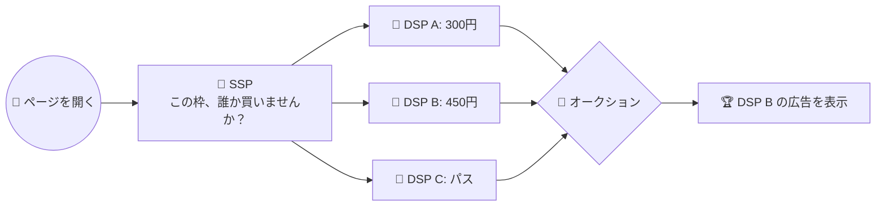

# RTB 入門 — デジタル広告の仕組みを図解で学ぶ

Web ページやアプリに広告が表示されるまでの **約 0.1 秒** の間に行われている「オークション」— **RTB（Real-Time Bidding）** の仕組みを、図とたとえ話でゼロから学ぶための資料です。

📖 **Web サイト版**: SITE_URL



## 目次

| # | 章 | 内容 |
|---|----|------|
| 1 | [デジタル広告の全体像](docs/01-overview.md) | 登場人物（広告主・媒体・DSP・SSP）とたとえ話 |
| 2 | [RTB の流れ](docs/02-rtb-flow.md) | 広告リクエストから表示までの 100ms |
| 3 | [OpenRTB プロトコル](docs/03-openrtb.md) | Bid Request / Bid Response の中身 |
| 4 | [オークション方式](docs/04-auction.md) | セカンドプライス・ファーストプライス・ヘッダービディング |
| 5 | [DSP の入札ロジック](docs/05-dsp-bidding.md) | 入札額の計算・CTR 予測・予算ペーシング |
| 6 | [取引形態](docs/06-deals.md) | オープンオークション・PMP・保証型 |
| 7 | [プライバシーと識別子](docs/07-privacy.md) | Cookie・広告 ID・同意管理・規制 |
| 8 | [透明性・品質・不正対策](docs/08-quality-fraud.md) | ads.txt・アドフラウド・ビューアビリティ |
| 9 | [指標と計算式](docs/09-metrics.md) | CPM・CTR・CPA・ROAS |
| – | [用語集](docs/glossary.md) / [確認問題](docs/quiz.md) | 復習用 |

## ハンズオン

```bash
python docs/examples/auction_simulator.py
```

オークション方式やフロアプライスで、媒体社の収益と DSP の利益がどう変わるかをシミュレーションします（Python 3.8+、標準ライブラリのみ）。
OpenRTB のサンプル JSON は [docs/examples/](docs/examples/) にあります。

## サイトをローカルで見る

```bash
pip install -r requirements.txt
mkdocs serve
```

`main` ブランチに push すると、GitHub Actions で GitHub Pages に自動公開されます（[.github/workflows/pages.yml](.github/workflows/pages.yml)）。

> ⚠️ アドテク業界、特にプライバシー関連は変化が速い分野です。本資料は 2026 年 11 月時点の理解に基づいています。実務では一次情報を確認してください。
