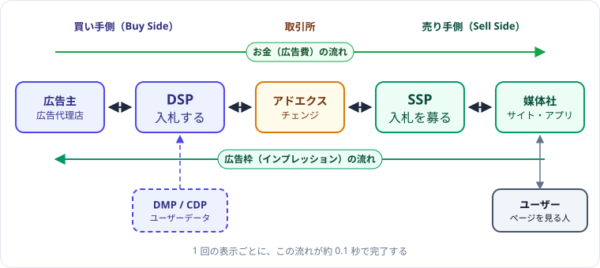

# RTB 入門 — デジタル広告のリアルタイム入札を、ゼロから理解する

[](https://github.com/yasut0ra/rtb-study/actions/workflows/pages.yml)
[](https://creativecommons.org/licenses/by/4.0/deed.ja)

Web ページを開いた瞬間に、広告枠をめぐって行われる約 0.1 秒のオークション「RTB（Real-Time Bidding）」を、図とたとえ話でゼロから解説する学習書です。

**Web 版で読む：<https://yasut0ra.github.io/rtb-study/>**

GitHub 上の Markdown でも読めますが、囲み記事・数式・脚注は Web 版で正しく表示されます。



## 目次

| 部 | 章 |
|----|----|
| — | [はじめに](docs/preface.md) |
| 第Ⅰ部 基礎 | [第1章 デジタル広告の全体像](docs/01-overview.md)・[第2章 RTB の流れ](docs/02-rtb-flow.md)・[第3章 OpenRTB プロトコル](docs/03-openrtb.md) |
| 第Ⅱ部 仕組みと戦略 | [第4章 オークション方式](docs/04-auction.md)・[第5章 DSP の入札ロジック](docs/05-dsp-bidding.md)・[第6章 取引形態](docs/06-deals.md) |
| 第Ⅲ部 周辺の課題 | [第7章 プライバシーと識別子](docs/07-privacy.md)・[第8章 透明性・品質・不正対策](docs/08-quality-fraud.md)・[第9章 指標と計算式](docs/09-metrics.md) |
| 付録 | [用語集](docs/glossary.md)・[確認問題](docs/quiz.md)・[参考文献](docs/references.md)・[奥付](docs/colophon.md) |

## ハンズオン

```bash
python docs/examples/auction_simulator.py
```

オークション方式やフロアプライスによって、媒体社の収益と DSP の利益がどう変わるかをシミュレーションします（Python 3.8 以降、標準ライブラリのみ）。OpenRTB 2.6 形式のサンプル JSON は[docs/examples/](docs/examples/)にあります。

## 執筆・ビルド

```bash
pip install -r requirements.txt   # サイト生成（MkDocs Material）
mkdocs serve                      # http://127.0.0.1:8000 でプレビュー

npm install                       # 校正ツール（textlint）
npm run lint                      # 日本語の表記ゆれ・文体をチェック

python tools/make_figures.py      # SVG 図版を再生成
```

文体や表記のルールは[CONTRIBUTING.md](CONTRIBUTING.md)にまとめています。
`main` ブランチへ push すると、GitHub Actions が校正とビルドを行い、GitHub Pages に公開します。

## ライセンス

- 文章・図版：[CC BY 4.0](LICENSE)（出典として「yasut0ra『RTB 入門』」と URL を表示してください）
- サンプルコード・スクリプト（`docs/examples/`、`tools/`）：[MIT](LICENSE-CODE)

誤りの指摘や改善の提案は[Issue](https://github.com/yasut0ra/rtb-study/issues)へお願いします。
