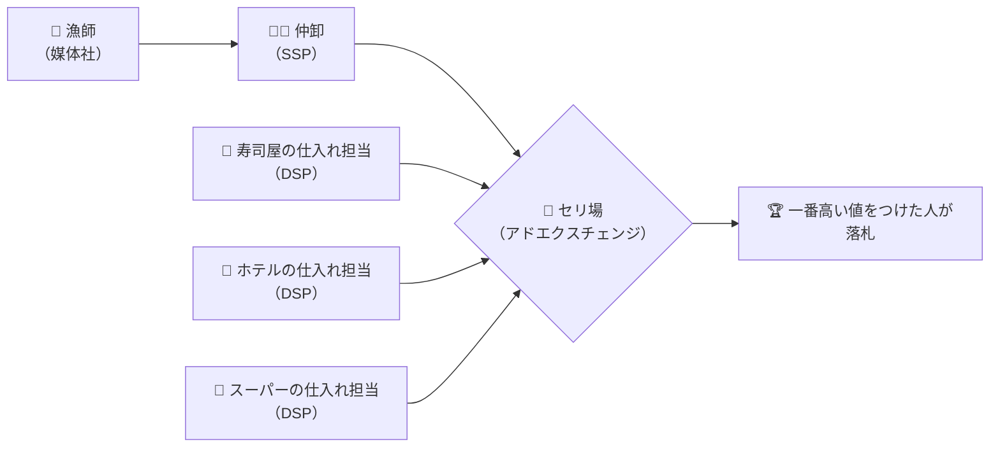
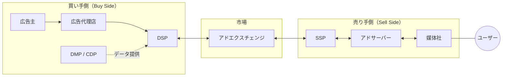
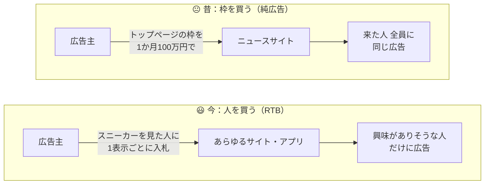
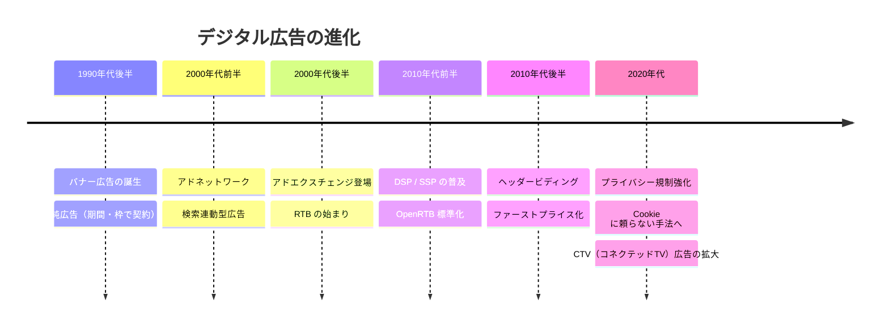

# 第1章 デジタル広告の全体像

> **この章のゴール**: RTB に登場する「プレイヤー」と、それぞれの立場（買い手か売り手か）を説明できるようになる。

## 🍣 たとえ話：築地のセリ市場

RTB は **魚市場のセリ** にとても似ています。

| 魚市場 | RTB |
|--------|-----|
| 1匹のマグロ | 1回の広告表示（インプレッション） |
| 漁師 | 媒体社（Webサイト・アプリ） |
| 仲卸 | SSP |
| セリ場 | アドエクスチェンジ |
| 仕入れ担当 | DSP |
| 寿司屋・ホテル | 広告主 |
| マグロの産地・重さ・脂ののり | ユーザー属性・広告枠の位置・サイトの種類 |

違いは、**セリが1回あたり 0.1 秒で、1日に何千億回も行われる** という点です。

## 1.1 広告の「枠」を売り買いする市場

デジタル広告は、ざっくり言えば **「広告を出したい人」と「広告枠を持っている人」をマッチングする市場** です。

- **広告主（Advertiser）**: 商品やサービスを宣伝したい企業。例: 化粧品メーカー、ECサイト、ゲーム会社
- **媒体社（Publisher / パブリッシャー）**: 広告枠を持つWebサイトやアプリの運営者。例: ニュースサイト、ブログ、無料アプリ

昔は、広告主（または広告代理店）と媒体社が **「この枠を1か月○○万円で」** と直接契約する **純広告（予約型広告）** が主流でした。
しかし、Webサイトとアプリが爆発的に増えた結果、人手で一つ一つ契約するのは不可能になりました。

そこで登場したのが、**広告枠を1インプレッション（1回の表示）単位で、機械が自動的に売買する仕組み** — **プログラマティック広告** です。
RTB はその中心となる取引方式です。

## 1.2 登場人物

| 名称 | 正式名称 | 役割 | 代表例 |
|------|---------|------|-------|
| **DSP** | Demand-Side Platform | 広告主側のツール。インプレッションごとに「買うか？いくらで買うか？」を判断して入札する | The Trade Desk, Google DV360, Amazon DSP |
| **SSP** | Supply-Side Platform | 媒体社側のツール。広告枠をできるだけ高く売るために、複数の DSP に入札を募る | Google Ad Manager, Magnite, PubMatic, fluct |
| **アドエクスチェンジ** | Ad Exchange | 買い手と売り手が出会う取引所。オークションを実施する | Google AdX |
| **アドサーバー** | Ad Server | 媒体社側で、どの広告（純広告・RTB など）を出すかを最終決定・配信する | Google Ad Manager |
| **DMP / CDP** | Data Management Platform / Customer Data Platform | ユーザーの行動データ・属性データを管理し、ターゲティングに使う | — |
| **アドネットワーク** | Ad Network | 多数の媒体の広告枠を束ねて販売する仕組み（RTB 以前から存在） | — |

> **ポイント**: 現在は SSP とアドエクスチェンジの機能はほぼ一体化しており、「SSP = アドエクスチェンジ」として扱われることも多いです。

## 1.3 なぜ RTB が生まれたのか

### 従来のアドネットワークの課題
- 広告枠を **まとめ売り** するため、「どのサイトの、誰に見せたか」が粗い
- 価格は固定 or 事前に決められた単価で、**インプレッションごとの価値の違い** を反映できない

### RTB がもたらしたもの
| 視点 | メリット |
|------|---------|
| 広告主 | **「誰に」見せるか** を1インプレッションごとに判断できる（オーディエンスターゲティング） |
| 媒体社 | 複数の買い手を競わせることで **最も高い値段** で売れる |
| ユーザー | （理想的には）自分に関係のある広告が表示される |

つまり、RTB は **「枠を買う」から「人（オーディエンス）を買う」** への転換を可能にしました。

### アドテクの歴史をざっくり

## 1.4 広告の課金モデル（さわり）

| モデル | 意味 | 誰がリスクを負うか |
|-------|------|------------------|
| **CPM** | 1,000 回表示あたりの単価（Cost Per Mille） | 広告主 |
| **CPC** | 1 クリックあたりの単価 | 中間（媒体・DSP） |
| **CPA** | 1 コンバージョン（購入・登録など）あたりの単価 | 媒体・DSP |

**RTB の入札は基本的に CPM 単位** で行われます。
広告主が CPC や CPA で目標を持っている場合、DSP がそれを CPM に「換算」して入札します（[第5章](05-dsp-bidding.md)）。

---

➡️ 次へ: [第2章 RTB の流れ](02-rtb-flow.md)
