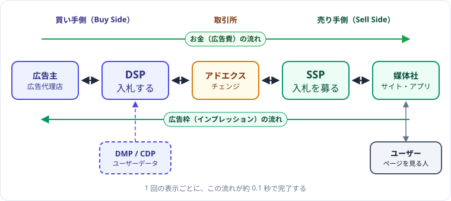
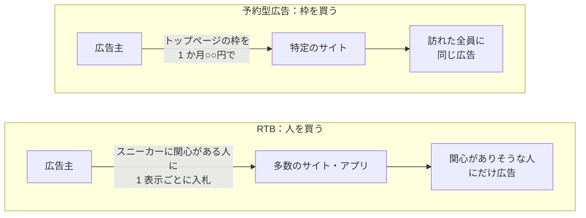
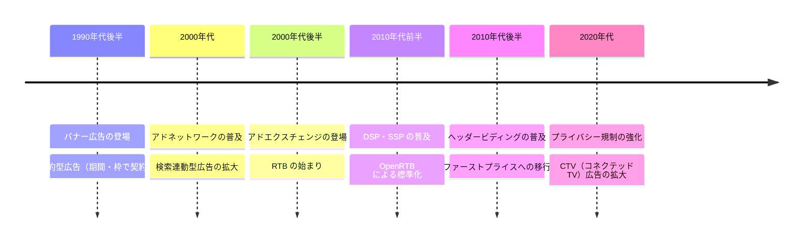

# 第1章 デジタル広告の全体像

Web ページを開いた瞬間、画面の広告枠をめぐって複数の企業が値段を競い合っています。本章では、その取引に登場するプレイヤーと、RTB が生まれた背景を整理します。

!!! abstract "この章で学ぶこと"

    - RTB に登場するプレイヤー（広告主・DSP・SSP・アドエクスチェンジ・媒体社）とそれぞれの役割
    - 「枠を買う」広告から「人を買う」広告への変化
    - RTB の入札が CPM（1,000 回表示あたりの価格）で行われる理由

## 1.1 広告枠の売り手と買い手

デジタル広告は、**広告を出したい企業**と**広告枠を持つ企業**を結びつける市場です。

- **広告主（Advertiser）**：商品やサービスを宣伝したい企業（化粧品メーカー、EC サイト、ゲーム会社など）
- **媒体社（Publisher）**：広告枠を持つ Web サイトやアプリの運営者（ニュースサイト、ブログ、無料アプリなど）

かつては、広告主（または広告代理店）と媒体社が「トップページの枠を 1 か月いくら」と直接契約する**予約型広告（純広告）**が主流でした。しかし Web サイトとアプリが爆発的に増えると、1 つずつ人手で契約することは不可能になります。

そこで生まれたのが、広告枠を **1 インプレッション（1 回の表示）単位で、システムが自動的に売買する仕組み**です。これを**プログラマティック広告**と呼び、その中心となる取引方式が **RTB（Real-Time Bidding）** です。

## 1.2 魚市場のセリにたとえる

RTB は魚市場のセリによく似ています。

| 魚市場 | RTB |
|--------|-----|
| 1 匹のマグロ | 1 回の広告表示（インプレッション） |
| 漁師 | 媒体社 |
| 仲卸 | SSP |
| セリ場 | アドエクスチェンジ |
| 仕入れ担当者 | DSP |
| 寿司店・ホテル | 広告主 |
| 産地・重さ・脂ののり | 広告枠の位置・サイトの内容・閲覧しているユーザーの属性 |

大きな違いは速度と規模です。RTB のセリは 1 回あたり約 0.1 秒で終わり、世界全体では 1 日に膨大な回数が繰り返されています。

## 1.3 登場するプレイヤー

<figure markdown="span">
  { width="760" }
  <figcaption>図1-1　RTB の登場人物と、お金・広告枠の流れ</figcaption>
</figure>

| 名称 | 正式名称 | 役割 | 主な例 |
|------|---------|------|-------|
| **DSP** | Demand-Side Platform | 広告主側のシステム。インプレッションごとに「買うか」「いくらで買うか」を判断して入札する | The Trade Desk、Google Display & Video 360、Amazon DSP |
| **SSP** | Supply-Side Platform | 媒体社側のシステム。広告枠をできるだけ高く売るため、複数の DSP に入札を募る | Google Ad Manager、Magnite、PubMatic |
| **アドエクスチェンジ** | Ad Exchange | 買い手と売り手が出会う取引所。オークションを実行する | Google Ad Manager の AdX 機能 |
| **アドサーバー** | Ad Server | 媒体社側で、予約型広告と RTB の広告などを比べ、最終的に表示する広告を決めて配信する | Google Ad Manager |
| **DMP / CDP** | Data Management Platform / Customer Data Platform | ユーザーの行動データや属性データを管理し、ターゲティングに活用する | — |
| **アドネットワーク** | Ad Network | 多数の媒体の広告枠を束ねて販売する仕組み。RTB 以前から存在する | — |

!!! note "SSP とアドエクスチェンジの違い"

    本来、SSP は「媒体社の代理人」、アドエクスチェンジは「中立な取引所」という位置づけでした。現在は多くの事業者が両方の機能を一体で提供しているため、実務では両者を区別せずに「SSP」と呼ぶことも少なくありません。

## 1.4 RTB が生まれた理由

### 従来のアドネットワークの課題

- 広告枠を**まとめ売り**するため、どのサイトの誰に表示したかが粗くしか分からない
- 価格は固定または事前に決めた単価であり、**インプレッションごとの価値の違い**を反映できない

### RTB がもたらしたもの

| 立場 | 得られたもの |
|------|---------|
| 広告主 | 1 インプレッションごとに「誰に見せるか」を判断できる（オーディエンスターゲティング） |
| 媒体社 | 複数の買い手を競わせることで、その時点で最も高い価格で売れる |
| ユーザー | 理想的には、自分の関心に近い広告が表示される |

RTB は、**「枠を買う」から「人（オーディエンス）を買う」への転換**を可能にしました。ただし「人を買う」ためにユーザーを識別する技術は、後にプライバシー上の大きな論点になります（[第7章](07-privacy.md)）。

図1-2　予約型広告と RTB の考え方の違い

## 1.5 アドテクの歩み

図1-3　デジタル広告取引の主な変遷

## 1.6 課金モデル

| モデル | 意味 | 成果が出ないときに損をするのは |
|-------|------|------------------|
| **CPM** | 1,000 回表示あたりの価格（Cost Per Mille） | 広告主 |
| **CPC** | 1 クリックあたりの価格（Cost Per Click） | 双方で分担 |
| **CPA** | 1 成果（購入・会員登録など）あたりの価格（Cost Per Acquisition） | 媒体社・配信事業者 |

**RTB の入札は原則として CPM で行います。**
広告主の目標が CPC や CPA で設定されている場合は、DSP がその目標を CPM に換算して入札額を決めます（[第5章](05-dsp-bidding.md)）。

!!! success "この章のまとめ"

    - RTB は、広告枠を 1 インプレッション単位でリアルタイムに競売する仕組みである
    - 買い手側には広告主と DSP、売り手側には媒体社と SSP がいて、アドエクスチェンジがオークションを実行する
    - RTB によって「枠を買う」広告から「人を買う」広告への転換が進んだ
    - 入札は CPM 単位で行われ、CPC・CPA の目標は DSP が CPM に換算する
