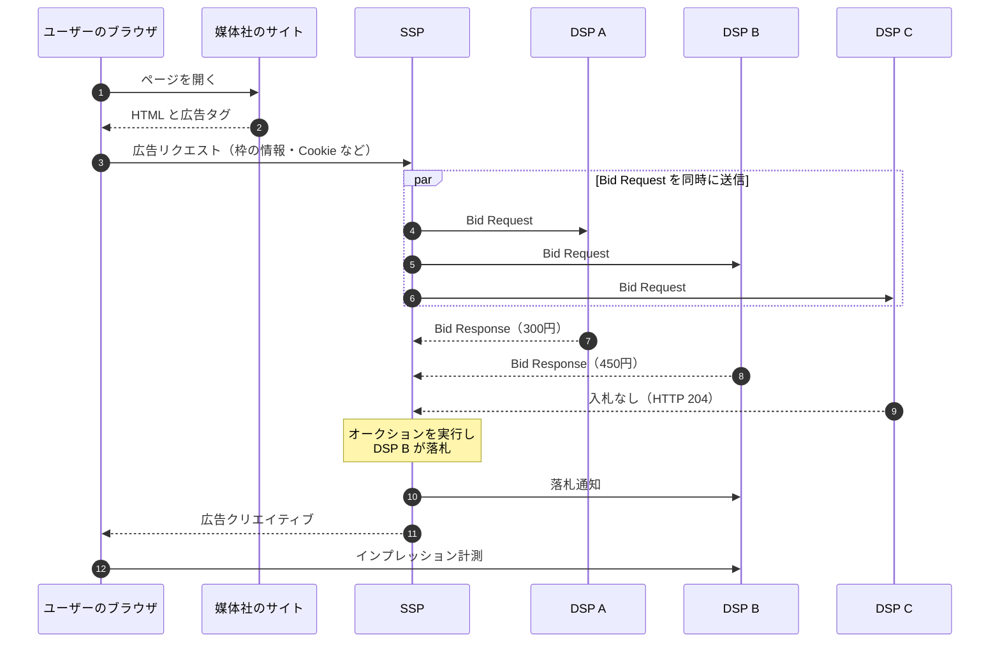
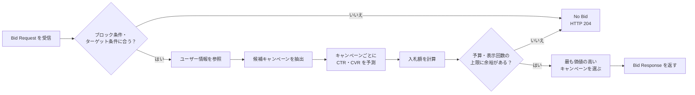
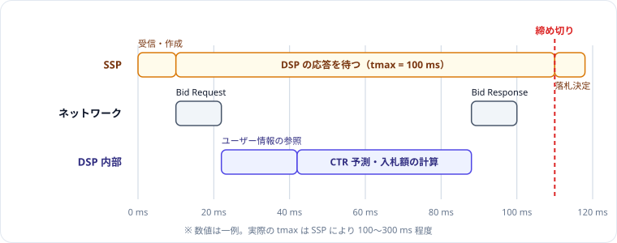
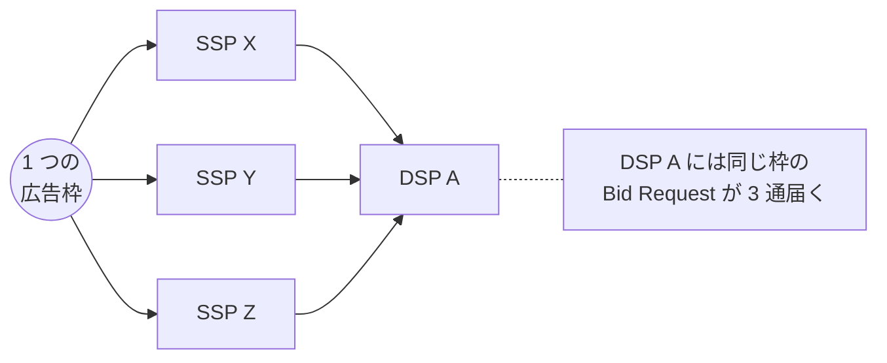

# 第2章 RTB の流れ

ユーザーがページを開いてから広告が表示されるまでの約 0.1 秒の間に、何が起きているのでしょうか。本章では、1 回のオークションを最初から最後まで順に追います。

!!! abstract "この章で学ぶこと"

    - 広告リクエストから広告表示までの一連のステップ
    - DSP が数十ミリ秒の間に行っている判断
    - 1 つの広告枠が複数の経路で同時に売りに出される構造

## 2.1 全体の流れ

図2-1　RTB の 1 回のオークションの流れ（金額は CPM、説明用の例）

## 2.2 各ステップの詳細

### ステップ 1・2：ページと広告タグの読み込み

媒体社のページには、SSP が提供する**広告タグ**（JavaScript）が埋め込まれています。アプリでは **SDK** が同じ役割を担います。

### ステップ 3：広告リクエスト

広告タグは SSP に広告を要求します。このリクエストには、次のような情報が含まれます。

- 広告枠のサイズと位置（例：300×250 ピクセル、ページを開いた直後に見える位置かどうか）
- ページの URL とカテゴリ
- ブラウザの情報（User-Agent、IP アドレスから推定した地域）
- Cookie の ID や広告 ID（取得できる場合）
- プライバシーに関する同意の状況（[第7章](07-privacy.md)）

### ステップ 4〜6：Bid Request の送信

SSP は受け取った情報を **OpenRTB** という標準形式（[第3章](03-openrtb.md)）に変換し、接続している複数の DSP に**同時に**送信します。

### ステップ 7〜9：DSP の判断と応答

各 DSP は数十ミリ秒のうちに、次の点を判断します。

1. このユーザーとこの広告枠は、自社の広告主のターゲットに合うか
2. 合う場合、どのキャンペーンで入札するか
3. いくらで入札するか（[第5章](05-dsp-bidding.md)）
4. 予算は残っているか

入札しない場合は、本文のない **HTTP 204（No Content）** を返します。これを **No Bid** と呼びます[^openrtb]。

図2-2　DSP の内部処理の概要

### オークションの実行（ステップ 9 と 10 の間）

SSP は、締め切り時間（`tmax`）までに届いた入札を比較して落札者を決めます。
**締め切りに間に合わなかった入札は無視されます。**

### ステップ 10：落札通知

落札した DSP には落札通知（Win Notice）や課金通知（Billing Notice）が送られ、落札価格が伝えられます。落札できなかった DSP には、敗退の理由を伝える通知（Loss Notice）が送られることもあります（[第3章](03-openrtb.md)）。

### ステップ 11・12：広告の表示と計測

ブラウザに広告クリエイティブが返され、表示されます。DSP や第三者の計測事業者は、計測用のピクセルなどで表示を記録します。

## 2.3 時間の制約

<figure markdown="span">
  { width="760" }
  <figcaption>図2-3　1 インプレッションの処理タイムライン（tmax = 100 ms の例）</figcaption>
</figure>

| 処理 | 目安 |
|------|------|
| SSP と DSP の間のネットワーク往復 | 数ミリ秒〜数十ミリ秒 |
| DSP 内部の入札判断 | 10〜50 ミリ秒程度 |
| SSP の締め切り（`tmax`） | 100〜300 ミリ秒程度 |

大規模な DSP は、1 秒間に数十万件以上の Bid Request を受け取ります。そのため DSP の入札サーバーには、低レイテンシと高スループットの両立が求められます。

!!! tip "コラム：入札サーバーを支える技術"

    入札サーバーは、ユーザー情報の参照にインメモリのキーバリューストア（Aerospike や Redis など）を使い、機械学習モデルの推論も数ミリ秒で終えるように設計されます。ネットワーク遅延を減らすため、SSP のデータセンターの近くに入札サーバーを配置することも一般的です。

## 2.4 1 つの広告枠が何度も売りに出される

1 つの広告枠は、1 つの SSP だけで売られるとは限りません。媒体社が複数の SSP と契約していれば、それぞれの SSP が同時にオークションを行い、その勝者どうしが媒体社側でさらに比較されます（ヘッダービディング、[第4章](04-auction.md)）。

図2-4　同じ広告枠が複数の SSP から届く

DSP から見ると、同じインプレッションの Bid Request が複数の経路から届きます。どの経路から買うのが効率的かを選ぶ取り組みが **SPO（Supply Path Optimization）** です（[第8章](08-quality-fraud.md)）。

!!! success "この章のまとめ"

    - 広告タグが SSP に広告を要求し、SSP が複数の DSP に Bid Request を同時に送る
    - DSP は数十ミリ秒で入札するかどうかと入札額を決め、入札しない場合は HTTP 204 を返す
    - SSP は締め切り（`tmax`）までに届いた入札だけでオークションを行う
    - 1 つの広告枠が複数の SSP から同時に売りに出されることがある

[^openrtb]: IAB Tech Lab, *OpenRTB 2.6*, 2022–. <https://github.com/InteractiveAdvertisingBureau/openrtb2.x/blob/main/2.6.md>
