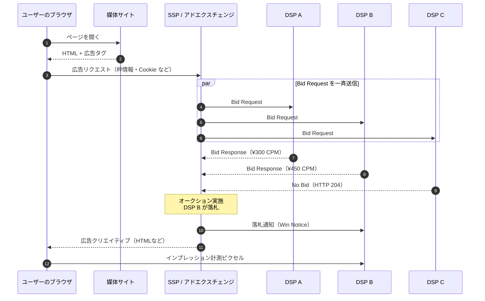
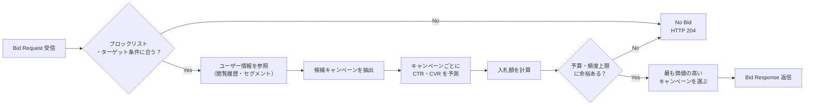
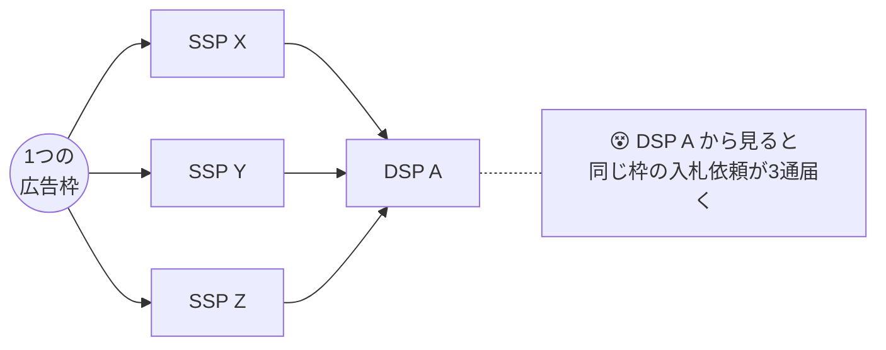

# 第2章 RTB の流れ — 広告が表示されるまでの 100ms

## 2.1 全体のシーケンス

ユーザーがニュースサイトを開いてから広告が表示されるまでを追ってみましょう。

## 2.2 ステップごとの解説

### ① ページを開く → ② 広告タグが読み込まれる
媒体ページには、SSP が提供する **広告タグ（JavaScript）** が埋め込まれています。アプリの場合は **SDK** が同じ役割を担います。

### ③ 広告リクエスト
広告タグは SSP に「この枠に広告を出したい」とリクエストを送ります。このとき以下のような情報が含まれます。

- 広告枠のサイズ・位置（例: 300×250、ファーストビュー内か）
- ページの URL・カテゴリ
- ユーザーのブラウザ情報（User-Agent、IP アドレスから推定した地域）
- Cookie ID や広告 ID（取得できる場合）
- 同意情報（GDPR などのプライバシー同意状況）

### ④ Bid Request の送信
SSP は受け取った情報を **OpenRTB** という標準フォーマット（[第3章](03-openrtb.md)）に変換し、接続している **複数の DSP に同時に送信** します。

### ⑤ 各 DSP の判断
各 DSP は **数十ミリ秒以内** に以下を判断します。

1. このユーザー・この枠は、自社の広告主のターゲットに合うか？
2. 合うなら、どの広告主のどのキャンペーンで入札するか？
3. いくらで入札するか？（[第5章](05-dsp-bidding.md)）
4. 予算は残っているか？

入札しない場合は **HTTP 204（No Content）** を返します。これを **No Bid** と呼びます。

### ⑥ オークション
SSP は締め切り時間（`tmax`、例: 100ms〜300ms）までに返ってきた入札を比較し、勝者を決めます。
**締め切りに間に合わなかった入札は無視** されます。

### ⑦ 落札通知
勝った DSP には **Win Notice（nurl）** や **Billing Notice（burl）** が送られ、落札価格が伝えられます。負けた DSP には **Loss Notice（lurl）** が送られる場合もあります。

### ⑧ 広告の表示と計測
ブラウザに広告クリエイティブが返され、表示されます。DSP や第三者計測ツールは **インプレッションピクセル** などで表示を計測します。

## 2.3 時間の制約

まばたき1回（約 100〜150ms）の間に、すべてが終わります。

```mermaid
gantt
    title 1インプレッションのタイムライン（例: tmax = 120ms）
    dateFormat x
    axisFormat %L ms
    section SSP
    広告リクエスト受信・Bid Request作成 :a1, 0, 10ms
    DSP の応答を待つ（tmax）             :crit, a2, after a1, 120ms
    オークション・勝者決定              :a3, after a2, 5ms
    section DSP（ネットワーク）
    Bid Request 受信                   :b1, 10, 15ms
    Bid Response 返信                  :b4, 95, 15ms
    section DSP（内部処理）
    ユーザー情報の参照（KVS）           :b2, 25, 20ms
    CTR予測・入札額計算                 :b3, 45, 50ms
```

| 処理 | 目安 |
|------|------|
| ページ読み込み〜広告リクエスト | ブラウザ依存 |
| SSP → DSP のネットワーク往復 | 数ms〜数十ms |
| DSP 内部の入札判断 | **10〜50ms 程度** |
| SSP のタイムアウト（`tmax`） | 100〜300ms 程度が一般的 |

### DSP の中では何が起きている？

DSP は **1秒間に数十万〜数百万件** の Bid Request を受け取ることもあります。
そのため DSP の入札サーバーは、低レイテンシ・高スループットが求められる、エンジニアリング的にも非常に面白いシステムです。

> 💡 **エンジニア向けメモ**: 入札サーバーでは、ユーザー情報の参照にインメモリ KVS（Aerospike, Redis など）を使い、機械学習モデルの推論も数ms以内に収める工夫がされます。ネットワーク遅延を減らすため、SSP のデータセンターの近くにサーバーを置くことも一般的です。

## 2.4 1つのインプレッションは何回オークションされる？

実は、1つの広告枠に対して **複数の SSP がそれぞれオークション** を行い、さらにその勝者同士が媒体側で比較されることがあります（ヘッダービディング、[第4章](04-auction.md)）。
また、1つの DSP が複数の SSP から **同じインプレッションの Bid Request** を受け取ることもあります。これが後述する **SPO（Supply Path Optimization）** の背景になっています。

---

⬅️ 前へ: [第1章 全体像](01-overview.md) ｜ ➡️ 次へ: [第3章 OpenRTB](03-openrtb.md)
