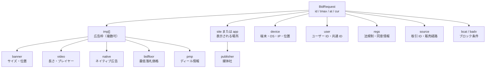
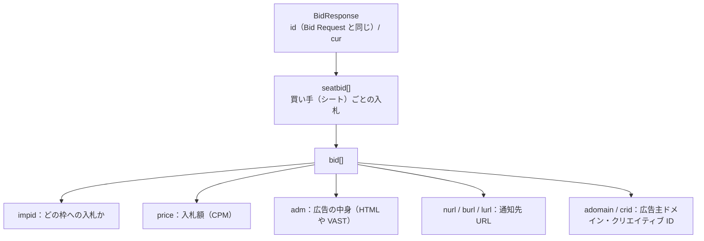
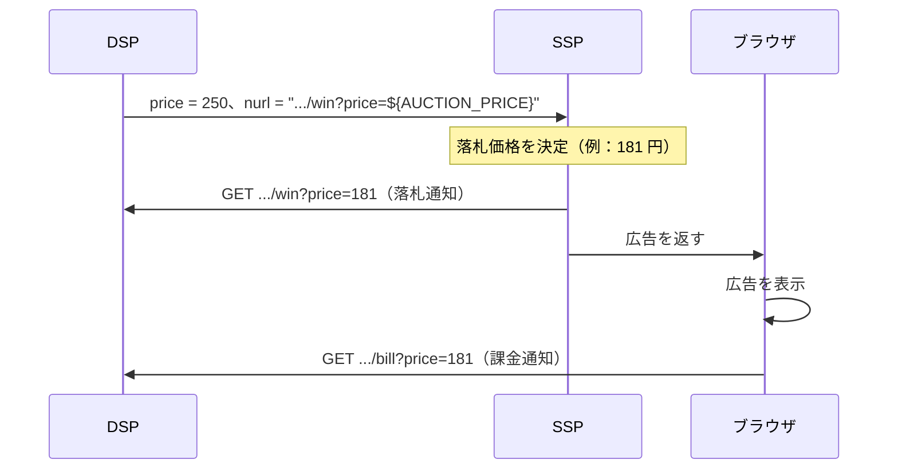
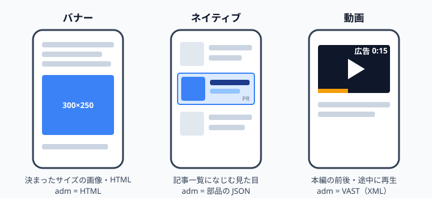

# 第3章 OpenRTB プロトコル

SSP と DSP は、1 秒間に何十万回もデータをやり取りします。そのやり取りの「共通言語」が OpenRTB です。本章では、実際に送受信される JSON の中身を読み解きます。

!!! abstract "この章で学ぶこと"

    - OpenRTB の役割と、2.x 系と 3.0 の関係
    - Bid Request と Bid Response の構造、主要なフィールドの意味
    - 落札通知・課金通知・敗退通知とマクロの仕組み

## 3.1 OpenRTB とは

**OpenRTB** は、SSP と DSP の間でやり取りするデータ形式と通信手順を定めた業界標準の仕様です。
米国の業界団体 **IAB Tech Lab** が策定し、GitHub で公開しています[^openrtb26]。

標準がなければ、DSP は接続する SSP ごとに異なる形式へ対応しなければなりません。OpenRTB によって、どの SSP とも同じ形式で通信できるようになりました。

| バージョン | 公開 | 特徴 |
|-----------|------|------|
| 2.5 | 2016 年 | 長く業界のデファクトスタンダードだったバージョン |
| **2.6** | 2022 年（以降も随時更新） | CTV 広告（広告ポッド）に対応し、`schain`・`eids`・`gpp` などを正式なフィールドに昇格。**現在の主流** |
| 3.0 | 2018 年 | 広告の中身の定義を別仕様 AdCOM に分離した新構造。公開後も普及は進まず、業界は 2.x を使い続けている |

!!! note "2.6 と AdCOM の関係"

    3.0 は普及しませんでしたが、3.0 とともに作られた **AdCOM**（Advertising Common Object Model）は 2.6 からも参照されています。
    `pos`（広告の位置）や `devicetype`（端末の種類）などの列挙値の一覧は、AdCOM 側で管理されています[^adcom]。

本書では **OpenRTB 2.6** に沿って説明します。

## 3.2 Bid Request の構造

Bid Request は「**どのような枠で、どのようなユーザーに、どのような条件で**広告を出せるか」を伝えるデータです。


<p class="figcap">図3-1　Bid Request を構成する主なオブジェクト</p>

### サンプル

主要な部分を抜粋し、コメントを加えたものを示します。完全版は[examples/bid_request.json](examples/bid_request.json)を参照してください。

```jsonc
{
  "id": "req-8f3a2c",               // リクエストの一意な ID
  "at": 1,                          // オークション方式（1 = ファーストプライス）
  "tmax": 120,                      // 応答の締め切り（ミリ秒）
  "cur": ["JPY"],                   // 入札に使える通貨
  "imp": [{
    "id": "1",
    "banner": { "w": 300, "h": 250, "pos": 1 },  // 300×250、pos = 1 はファーストビュー内
    "bidfloor": 80,                 // 最低落札価格（CPM、80 円）
    "bidfloorcur": "JPY"
  }],
  "site": {
    "domain": "news.example.jp",
    "page": "https://news.example.jp/sports/12345",
    "cat": ["IAB17"],               // コンテンツのカテゴリ（IAB17 = スポーツ）
    "publisher": { "id": "pub-123" }
  },
  "device": {
    "ua": "Mozilla/5.0 (iPhone; ...)",
    "geo": { "country": "JPN", "region": "13" },  // region は ISO 3166-2 の下位区分（JP-13 = 東京都）
    "devicetype": 4,                // 4 = スマートフォン
    "os": "iOS"
  },
  "user": { "id": "ssp-user-abc123", "buyeruid": "dsp-user-xyz789" },
  "bcat": ["IAB25", "IAB26"]        // 表示を拒否する広告カテゴリ
}
```

### 主要なフィールド

| フィールド | 意味 | DSP がここから判断すること |
|-----------|------|--------------------------|
| `tmax` | 応答の締め切り（ミリ秒） | 間に合わないなら入札しない |
| `at` | オークション方式。1 = ファーストプライス、2 = Second Price Plus（省略時の既定値） | 1 なら入札額を引き下げる（[第4章](04-auction.md)） |
| `imp.banner.w` / `h` / `format` | 広告枠のサイズ | 合うクリエイティブがあるか |
| `imp.bidfloor` | 最低落札価格 | この価格以上を払う価値があるか |
| `imp.pmp.deals` | ディールの情報 | 特別な取引条件の枠か（[第6章](06-deals.md)） |
| `site.domain` / `app.bundle` | 媒体 | 出稿してよい媒体か、ブロックリストに入っていないか |
| `device.geo` | 地域 | 地域ターゲティングの条件に合うか |
| `user.buyeruid` | DSP が付与したユーザー ID | 自社サイトを訪れたことがある人か（リターゲティング） |
| `user.eids` | 共通 ID（UID2 など） | Cookie がなくても同じ人だと分かるか |
| `regs.gdpr` / `regs.gpp` | 法規制と同意の情報 | データを使ってよいか（[第7章](07-privacy.md)） |
| `source.schain` | 販売経路の記録 | 正規の販売経路か（[第8章](08-quality-fraud.md)） |
| `bcat` / `badv` | 拒否する広告カテゴリ・広告主ドメイン | 出してはいけない業種・広告主か |

!!! note "ID の対応づけ"

    `user.id` は SSP が付与した ID、`user.buyeruid` は DSP が付与した ID です。
    2 つの ID を結びつける仕組みを **Cookie Sync** と呼びます（[第7章](07-privacy.md)）。

!!! warning "カテゴリコードと User-Agent に関する注意"

    - `IAB17` や `IAB25` は **Content Taxonomy 1.0** のコードです。OpenRTB 2.6 では `cattax` フィールドで使用するタクソノミーを指定でき、省略時は 1.0 とみなされます。現在は、コンテンツの分類に Content Taxonomy 2.x・3.x、広告の分類に Ad Product Taxonomy を使うことが推奨されています[^taxonomy]。
    - User-Agent 文字列の情報削減が進んでいるため、2.6 では構造化された User-Agent 情報である `device.sua` の利用が推奨されています。

## 3.3 Bid Response の構造

Bid Response は、DSP が「**この広告を、この価格で出したい**」と返すデータです。


<p class="figcap">図3-2　Bid Response を構成する主なオブジェクト</p>

```jsonc
{
  "id": "req-8f3a2c",               // 対応する Bid Request の id
  "cur": "JPY",
  "seatbid": [{
    "seat": "agency-001",
    "bid": [{
      "id": "bid-001",
      "impid": "1",                 // imp.id = "1" への入札
      "price": 250.0,               // 入札額（CPM、250 円）
      "adm": "<a href='...'></a>",
      "adomain": ["sneaker-shop.example"],
      "crid": "creative-123",
      "w": 300, "h": 250,
      "nurl": "https://dsp.example/win?price=${AUCTION_PRICE}",
      "burl": "https://dsp.example/bill?price=${AUCTION_PRICE}",
      "lurl": "https://dsp.example/loss?reason=${AUCTION_LOSS}"
    }]
  }]
}
```

入札しない場合は、本文のない **HTTP 204 No Content** を返すのが一般的です。

## 3.4 通知 URL とマクロ

`${AUCTION_PRICE}` のような**マクロ**は、SSP が通知を送る直前に実際の値へ置き換えます。


<p class="figcap">図3-3　マクロの置き換えと通知のタイミング（at = 2 の場合の例）</p>

| URL | 送られるタイミング | 用途 |
|-----|----------|------|
| `nurl`（Win Notice） | オークションで落札したとき | 落札の記録 |
| `burl`（Billing Notice） | 広告が課金対象となる表示に至ったとき | **課金の基準** |
| `lurl`（Loss Notice） | 落札できなかったとき | 敗退理由の分析（`${AUCTION_LOSS}` に理由コードが入る） |

| 主なマクロ | 置き換わる値 |
|-----------|------------|
| `${AUCTION_PRICE}` | 落札価格（暗号化されることが多い） |
| `${AUCTION_ID}` | Bid Request の `id` |
| `${AUCTION_IMP_ID}` | 対象の `imp.id` |
| `${AUCTION_LOSS}` | 敗退理由のコード |

!!! question "なぜ落札通知と課金通知を分けるのか"

    オークションで落札しても、ユーザーがすぐにページを離れるなどして**広告が実際には表示されない**ことがあります。表示されていない広告に課金するのは不公平なので、表示を確認してから課金する `burl` が使われるようになりました。

## 3.5 広告フォーマットによる違い

<figure markdown="span">
  { width="720" }
  <figcaption>図3-4　主な広告フォーマット</figcaption>
</figure>

| フォーマット | `imp` 内のオブジェクト | `adm` に入るもの |
|-------------|---------------------|-------------|
| バナー | `banner` | HTML / JavaScript |
| 動画 | `video` | **VAST**（動画広告用の XML） |
| ネイティブ | `native` | ネイティブ広告用の JSON（タイトル・画像・説明文などの部品） |
| 音声 | `audio` | VAST（4.1 以降）[^daast] |

!!! success "この章のまとめ"

    - OpenRTB は IAB Tech Lab が策定する RTB の標準仕様で、現在の主流は 2.6 である
    - Bid Request は枠・媒体・端末・ユーザー・規制情報を、Bid Response は入札額と広告の中身を運ぶ
    - 落札通知（`nurl`）・課金通知（`burl`）・敗退通知（`lurl`）は、マクロで実際の値に置き換えて送られる
    - 動画と音声の広告は VAST で記述する

[^openrtb26]: IAB Tech Lab, *OpenRTB 2.6*, 2022–. <https://github.com/InteractiveAdvertisingBureau/openrtb2.x/blob/main/2.6.md>
[^adcom]: IAB Tech Lab, *AdCOM (Advertising Common Object Model)*. <https://github.com/InteractiveAdvertisingBureau/AdCOM>
[^taxonomy]: IAB Tech Lab, *Taxonomies*. <https://github.com/InteractiveAdvertisingBureau/Taxonomies>
[^daast]: 音声広告用の仕様 DAAST は、2018 年に公開された VAST 4.1 に統合され、非推奨になりました。IAB Tech Lab, *VAST (Video Ad Serving Template)*. <https://iabtechlab.com/standards/vast/>
