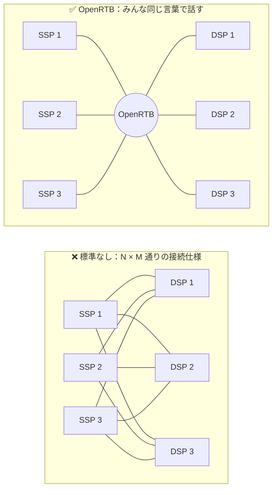
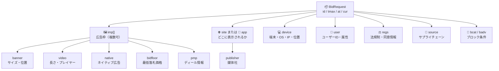
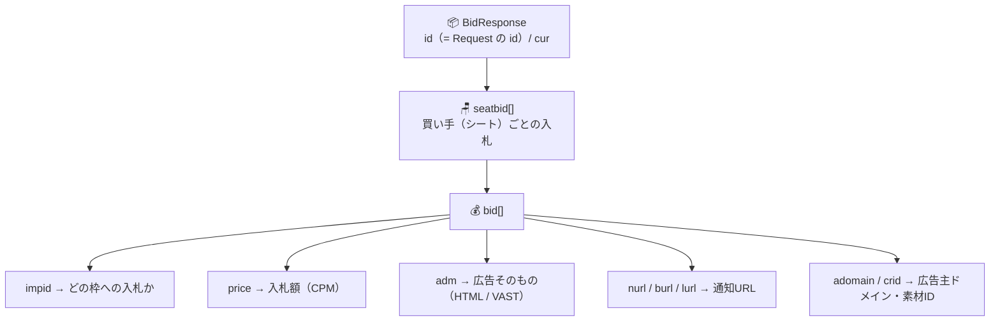
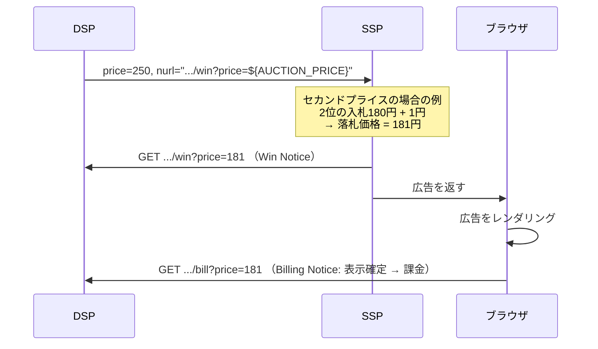

# 第3章 OpenRTB プロトコル — やり取りされるデータの中身

> **この章のゴール**: Bid Request / Bid Response の JSON を見て、主要なフィールドの意味がわかるようになる。

## 3.1 OpenRTB とは

**OpenRTB** は、SSP と DSP の間でやり取りするデータ形式を定めた **業界標準の仕様** です。
米国の業界団体 **IAB Tech Lab** が策定しています。

もし標準がなかったら、DSP は SSP ごとに違う形式に対応しなければなりません。



| バージョン | 公開 | 主な特徴 |
|-----------|------|---------|
| 2.5 | 2016年 | 長く業界のデファクトだったバージョン |
| **2.6** | 2022年〜（随時更新） | CTV 広告（ポッド）対応、`schain`・`eids` などを正式フィールド化。**現在の主流** |
| 3.0 | 2018年〜 | 広告の中身の定義（AdCOM）を分離した新構造。普及はこれから |

本資料では **OpenRTB 2.6** をベースに説明します。

## 3.2 Bid Request の構造

Bid Request は「**どんな枠で、どんなユーザーに、どんな条件で** 広告を出せるか」を伝えるデータです。



### サンプル（簡略版）

完全版は [examples/bid_request.json](examples/bid_request.json) を参照してください。

```jsonc
{
  "id": "req-8f3a2c",               // リクエストの一意なID
  "at": 1,                          // オークション方式: 1=ファーストプライス, 2=セカンドプライス
  "tmax": 120,                      // この時間（ms）以内に応答して！
  "cur": ["JPY"],                   // 入札通貨
  "imp": [{
    "id": "1",
    "banner": { "w": 300, "h": 250, "pos": 1 },  // 300×250, pos=1 はファーストビュー内
    "bidfloor": 80,                 // 最低価格: 80円 CPM
    "bidfloorcur": "JPY"
  }],
  "site": {
    "domain": "news.example.jp",
    "page": "https://news.example.jp/sports/12345",
    "cat": ["IAB17"],               // コンテンツカテゴリ（スポーツ）
    "publisher": { "id": "pub-123" }
  },
  "device": {
    "ua": "Mozilla/5.0 (iPhone; ...)",
    "geo": { "country": "JPN", "region": "13" },  // 東京都
    "devicetype": 4,                // 4 = スマートフォン
    "os": "iOS"
  },
  "user": { "id": "ssp-user-abc123", "buyeruid": "dsp-user-xyz789" },
  "regs": { "coppa": 0 },
  "bcat": ["IAB25", "IAB26"]        // ブロックする広告カテゴリ
}
```

### 主要フィールドの早見表

| フィールド | 意味 | ここを見て DSP が考えること |
|-----------|------|--------------------------|
| `tmax` | 応答の締め切り（ms） | 間に合わないなら入札しない |
| `at` | オークション方式 | 1 ならファーストプライス → 入札額を下げる（[第4章](04-auction.md)） |
| `imp.banner.w/h`, `format` | 枠サイズ | 合うクリエイティブがあるか |
| `imp.bidfloor` | 最低価格 | これ以上で入札する価値があるか |
| `imp.pmp.deals` | ディール ID | 特別契約の枠か（[第6章](06-deals.md)） |
| `site.domain`, `app.bundle` | 媒体 | ブランドセーフか、ブロックリストに入っていないか |
| `device.geo` | 地域 | 地域ターゲティングに合うか |
| `user.buyeruid` | DSP 側のユーザーID | 過去に自社サイトを訪問した人か（リターゲティング） |
| `user.eids` | 共通ID（UID2 など） | Cookie がなくても人を識別できるか |
| `regs.gdpr`, `regs.gpp` | 同意情報 | データを使ってよいか |
| `source.schain` | 販売経路 | 正規の販売経路か（[第8章](08-quality-fraud.md)） |
| `bcat`, `badv` | ブロック条件 | 出してはいけない業種・広告主か |

> 💡 `user.id` は SSP が振った ID、`user.buyeruid` は DSP が振った ID です。
> この2つを結びつけるのが **Cookie Sync（クッキーシンク）** という仕組みです（[第7章](07-privacy.md)）。

## 3.3 Bid Response の構造

DSP が「**この広告を、この値段で出したい**」と返すデータです。



```jsonc
{
  "id": "req-8f3a2c",               // Bid Request の id と同じ
  "cur": "JPY",
  "seatbid": [{
    "seat": "agency-001",
    "bid": [{
      "id": "bid-001",
      "impid": "1",                 // imp.id = "1" への入札
      "price": 250.0,               // 250円 CPM で入札
      "adm": "<a href='...'></a>",
      "adomain": ["sneaker-shop.example"],
      "crid": "creative-123",
      "w": 300, "h": 250,
      "nurl": "https://dsp.example/win?price=${AUCTION_PRICE}",
      "burl": "https://dsp.example/bill?price=${AUCTION_PRICE}",
      "lurl": "https://dsp.example/loss?reason=${AUCTION_LOSS}"
    }]
  }]
}
```

入札しない場合は、**HTTP 204 No Content**（本文なし）を返すのが一般的です。

## 3.4 通知 URL とマクロ

`${AUCTION_PRICE}` のような **マクロ** は、SSP が通知を送る直前に **実際の値に置き換え** ます。



| URL | タイミング | 用途 |
|-----|----------|------|
| `nurl`（Win Notice） | オークションで勝ったとき | 落札の記録 |
| `burl`（Billing Notice） | 広告が実際に表示（課金対象）になったとき | **課金の基準** |
| `lurl`（Loss Notice） | 負けたとき | 負けた理由の分析（`${AUCTION_LOSS}` に理由コード） |

| 主なマクロ | 置き換わる値 |
|-----------|------------|
| `${AUCTION_PRICE}` | 落札価格（※暗号化されることも多い） |
| `${AUCTION_ID}` | Bid Request の id |
| `${AUCTION_IMP_ID}` | imp の id |
| `${AUCTION_LOSS}` | 負けた理由のコード |

> ⚠️ **なぜ Win と Billing を分けるの？** — オークションに勝っても、ユーザーがすぐページを離れるなどして **広告が実際には表示されない** ことがあります。
> 表示されていないのに課金されるのは不公平なので、「表示された」ことを確認してから課金する `burl` が使われるようになりました。

## 3.5 フォーマットごとの違い

| フォーマット | `imp` 内のオブジェクト | `adm` の中身 |
|-------------|---------------------|-------------|
| バナー | `banner` | HTML / JavaScript |
| 動画 | `video` | **VAST**（動画広告用の XML） |
| ネイティブ | `native` | ネイティブ広告用 JSON（タイトル・画像・説明文などの部品） |
| 音声 | `audio` | DAAST / VAST |


---

⬅️ 前へ: [第2章 RTB の流れ](02-rtb-flow.md) ｜ ➡️ 次へ: [第4章 オークション方式](04-auction.md)
