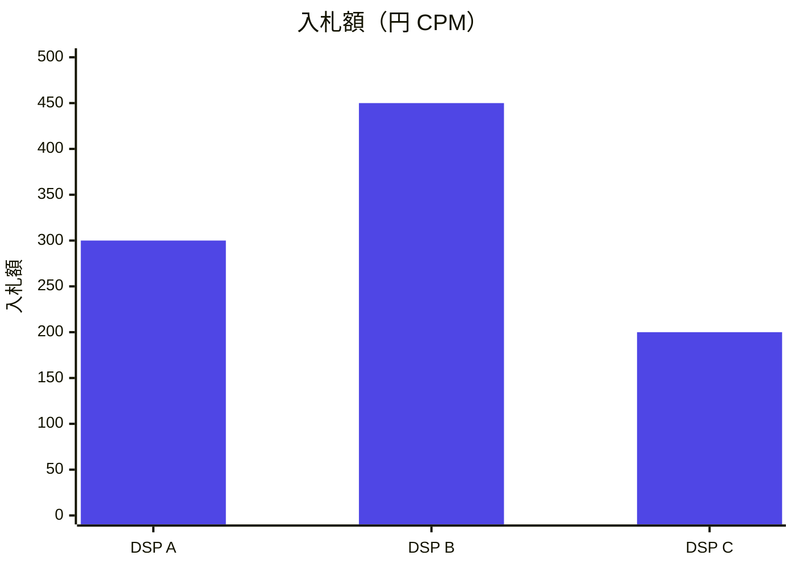
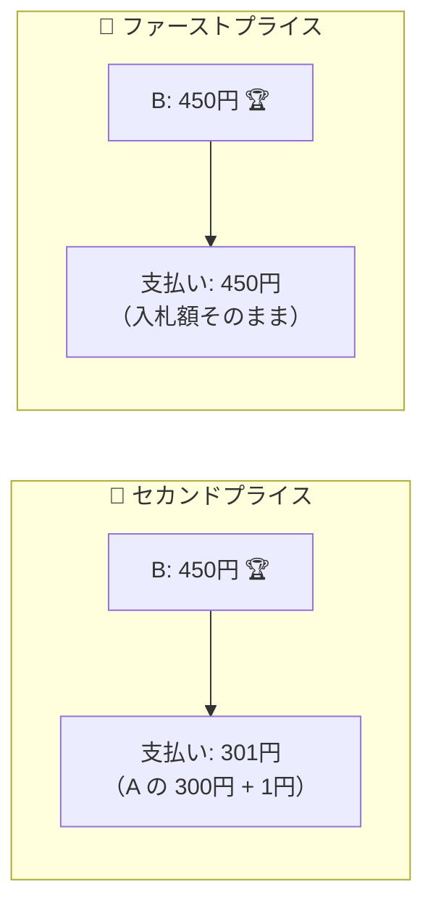
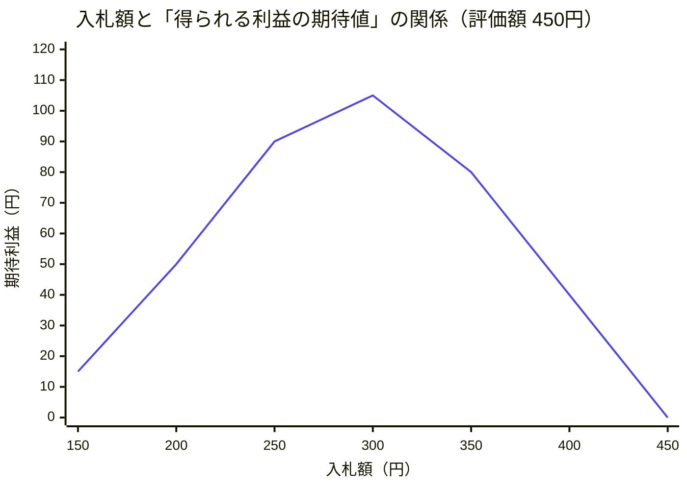
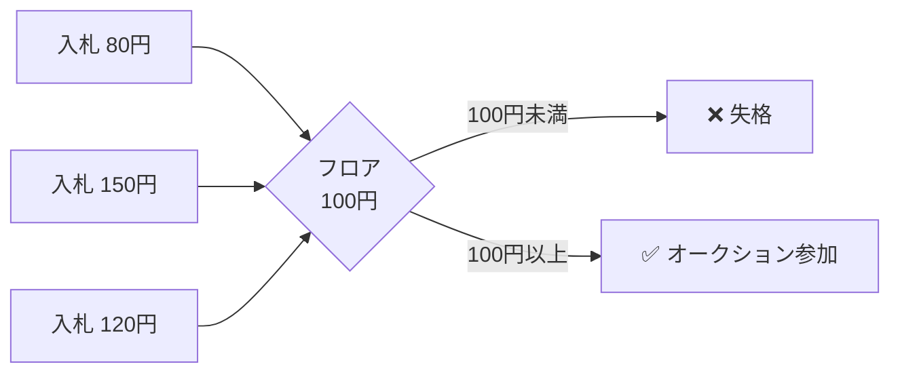
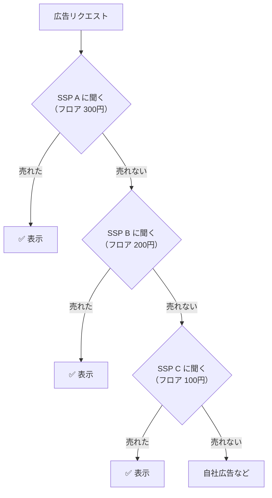
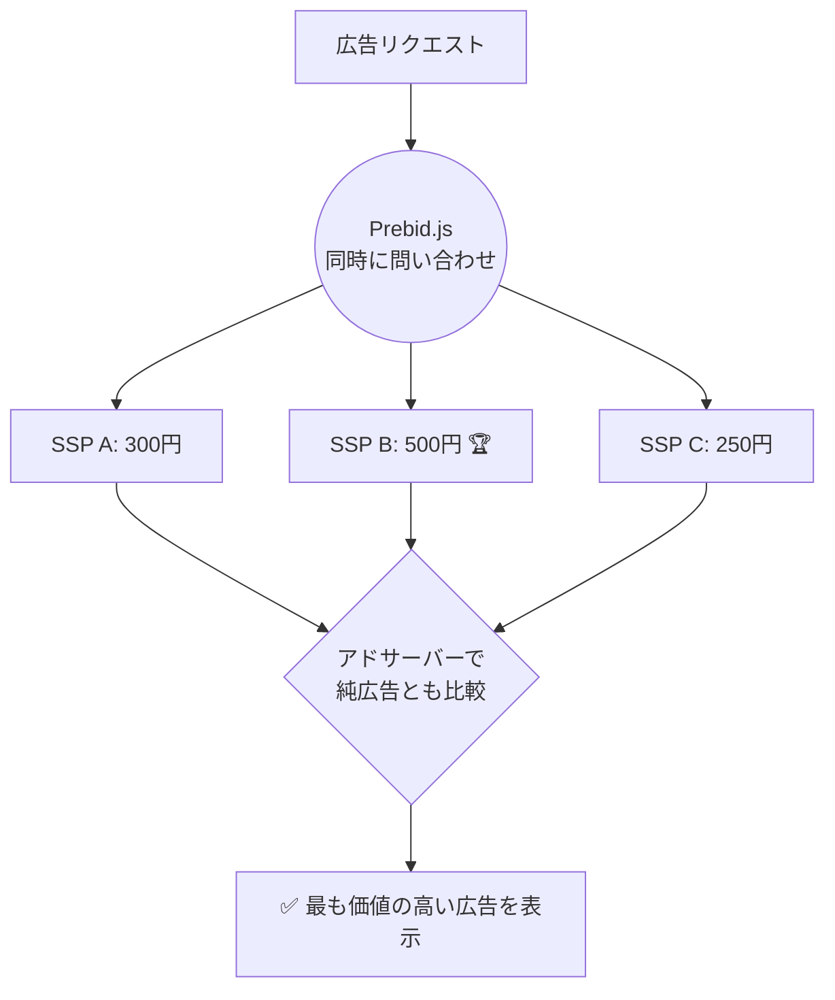
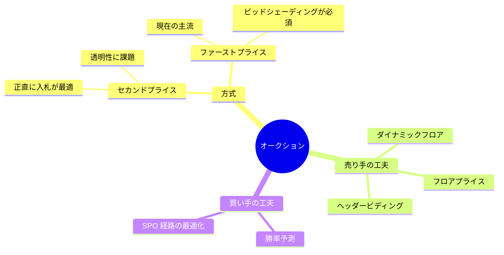

# 第4章 オークション方式

> **この章のゴール**: セカンドプライスとファーストプライスの違い、ビッドシェーディング、ヘッダービディングを説明できるようになる。

## 4.1 2つのオークション方式

3社の DSP が次のように入札したとします（最低落札価格 = 100円）。

| | 🥈 セカンドプライス | 🥇 ファーストプライス |
|-|------------------|-------------------|
| 勝者 | DSP B（450円） | DSP B（450円） |
| **支払額** | **2位の価格 + 1円 = 301円** | **自分の入札額 = 450円** |
| 考え方 | 「勝ったら、2番目の人の値段で買える」 | 「言った値段をそのまま払う」 |

### セカンドプライスの良いところ：正直が一番

セカンドプライスでは、**「自分が本当に払ってもいいと思う金額（＝評価額）」をそのまま入札するのが最適** です。
（経済学では **ヴィックリー・オークション** と呼ばれ、この性質を「耐戦略性」と言います）

- 評価額より **高く** 入札 → 評価額以上の値段で買わされるリスク
- 評価額より **低く** 入札 → 本来勝てたオークションを落とすリスク
- 支払額は他人の入札で決まるので、自分の入札額をいじっても得しない

### では、なぜ業界はファーストプライスに移行したのか？

2017年頃から **ヘッダービディング**（4.4節）が普及し、さらに 2019 年に Google AdX がファーストプライスへ移行したことで、現在は **ファーストプライスが主流** になりました。

主な理由:

1. **多段階オークションでセカンドプライスが崩れた** — SSP ごとのオークションの勝者が、さらに媒体側で比べられる構造では「2位の価格」の意味があいまいになる
2. **透明性の問題** — 「2位の価格」を DSP が検証できず、SSP が不透明な手数料を上乗せする余地があった（"ソフトフロア" など）
3. **シンプルさ** — 「入札額 = 支払額」はわかりやすい

## 4.2 ビッドシェーディング（Bid Shading）

ファーストプライスで評価額そのままを入札すると、**払いすぎ** になります。

> 例: 評価額 450円 で入札して勝った。でも実は 2位は 300円 だった。
> → 本当は 301円 で十分勝てたのに、149円 も余計に払った 😢

そこで DSP は、**「勝てるギリギリの金額」を予測して入札額を下げる** 工夫をします。これが **ビッドシェーディング** です。

- 入札額を **下げる** → 勝ったときの利益（評価額 − 支払額）は **増える** が、**勝率は下がる**
- 入札額を **上げる** → 勝率は **上がる** が、利益は **減る**
- その **掛け算（期待利益）が最大になる点** を探す

$$
\text{期待利益}(b) = \underbrace{P(\text{勝つ} \mid b)}_{\text{勝率}} \times \underbrace{(v - b)}_{\text{勝ったときの利益}}
$$

（$v$: 評価額、$b$: 入札額）

DSP は過去の勝ち負けのデータ（`lurl` で届く情報や、勝ったときの価格）から **勝率曲線** を学習し、最適な $b$ を計算します。

> 🧪 [examples/auction_simulator.py](examples/auction_simulator.py) を実行すると、シェーディングの有無で DSP の利益と媒体の収益がどう変わるかを確認できます。

## 4.3 フロアプライス（最低落札価格）

媒体社は「この値段以下なら売らない」という **フロアプライス** を設定できます（`imp.bidfloor`）。

| フロアの設定 | 結果 |
|------------|------|
| 低すぎる | 安く売れてしまう |
| 高すぎる | 誰も入札せず **売れ残る**（Fill Rate 低下） |
| ちょうどいい | 収益が最大化 |

多くの SSP は、過去の入札データから **最適なフロアを自動で調整** する機能を持っています（ダイナミックフロア）。

## 4.4 ウォーターフォールとヘッダービディング

### ウォーターフォール（昔の方法）

媒体社が SSP に **優先順位をつけて、順番に** 問い合わせる方式です。

**問題点**: SSP A で 300円 で売れたとき、実は SSP B に 500円 で買いたい人がいても、**聞く前に終わってしまう**。また、順番に問い合わせるので遅い。

### ヘッダービディング（今の主流）

すべての SSP に **同時に** 問い合わせ、一番高いところに売る方式です。
ページの `<head>` 内のスクリプトで実行されることから、この名前がつきました。オープンソースの **Prebid.js** が事実上の標準です。

| 方式 | 処理場所 | メリット | デメリット |
|-----|--------|---------|----------|
| **クライアントサイド** | ユーザーのブラウザ | 導入が簡単、Cookie が使いやすい | ページが重くなる |
| **サーバーサイド**（Prebid Server など） | サーバー | ページが軽い、多くの SSP を呼べる | Cookie の扱いが難しい |

## 4.5 まとめ

---

⬅️ 前へ: [第3章 OpenRTB](03-openrtb.md) ｜ ➡️ 次へ: [第5章 DSP の入札ロジック](05-dsp-bidding.md)
