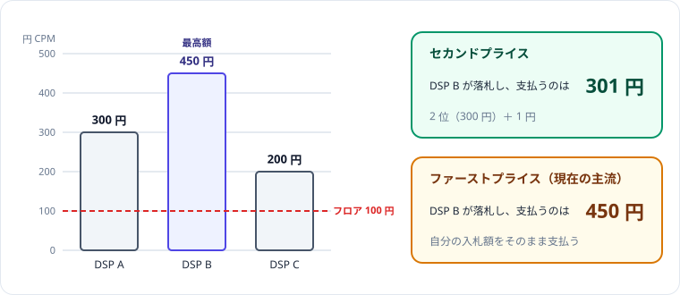
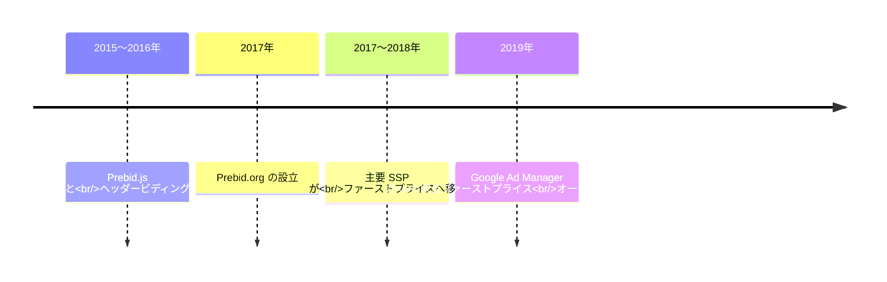
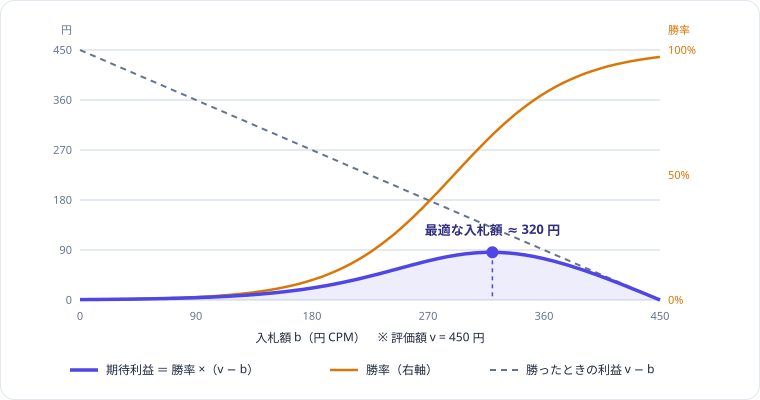
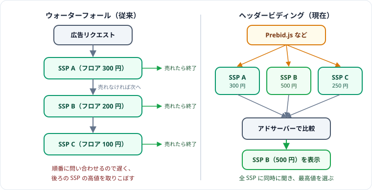

# 第4章 オークション方式

同じ入札でも、オークションのルールが違えば支払う金額も、最適な入札戦略も変わります。本章では、RTB で使われる 2 つの方式と、ルールの変化が買い手と売り手に与えた影響を説明します。

!!! abstract "この章で学ぶこと"

    - セカンドプライスとファーストプライスの違い
    - 業界がファーストプライスへ移行した理由と、それに伴うビッドシェーディング
    - フロアプライス、ウォーターフォール、ヘッダービディングの仕組み

## 4.1 オークションの 2 つの方式

3 社の DSP が、最低落札価格（フロアプライス）100 円の広告枠に入札した例で考えます。

<figure markdown="span">
  { width="760" }
  <figcaption>図4-1　セカンドプライスとファーストプライスの支払額の違い（金額は CPM、説明用の例）</figcaption>
</figure>

| | セカンドプライス | ファーストプライス |
|-|------------------|-------------------|
| 落札者 | DSP B（450 円） | DSP B（450 円） |
| **支払額** | **2 位の入札額＋最小単位＝301 円** | **自分の入札額＝450 円** |
| 考え方 | 落札者は 2 番目に高い入札額で買える | 入札した金額をそのまま支払う |

!!! note "「＋1 円」について"

    2 位の入札額にいくら上乗せするか（最小単位）は SSP によって異なります。本書では説明のため 1 円としています。なお OpenRTB では `at = 2` を単なる「セカンドプライス」ではなく **Second Price Plus** と呼びます。

### セカンドプライスの性質：正直な入札が最適

セカンドプライスでは、**自分が払ってもよいと考える上限額（評価額）をそのまま入札する**のが最適な戦略になります。経済学ではこの方式を**ヴィックリー・オークション**と呼び、このような性質を**耐戦略性**と言います。

- 評価額より**高く**入札すると、評価額を上回る価格で買わされるおそれがある
- 評価額より**低く**入札すると、本来は勝てたオークションを落とすおそれがある
- 支払額は他者の入札で決まるため、自分の入札額を操作しても得をしない

!!! warning "理論が成り立つ条件"

    この性質は、1 回限りのオークションで予算の制約がないなど、理想的な条件のもとでの話です。SSP が不透明な「ソフトフロア」を設けている場合や、複数のオークションが多段に重なる場合には成り立ちません。

### ファーストプライスへの移行

RTB の初期はセカンドプライスが主流でしたが、現在は**ファーストプライスが主流**です。


<p class="figcap">図4-2　ファーストプライスへの移行の経緯</p>

移行した主な理由は次の 3 点です。

1. **多段オークションでセカンドプライスの意味が崩れた**：SSP ごとのオークションの勝者が、さらに媒体社側で比較される構造（4.4 節）では、「2 位の価格」の意味があいまいになる
2. **透明性の問題**：DSP は「2 位の価格」を検証できず、SSP が不透明なフロアや手数料を上乗せする余地があった
3. **分かりやすさ**：「入札額＝支払額」というルールは、買い手と売り手の双方にとって単純で明快である

Google は 2019 年 3 月に Google Ad Manager の統合ファーストプライスオークションへの移行を発表し、同年中に移行を完了しました。このとき、特定の買い手が他社の入札を見てから入札できる「ラストルック」も廃止されています[^google2019a][^google2019b]。

## 4.2 ビッドシェーディング

ファーストプライスで評価額をそのまま入札すると、**払いすぎ**になります。

> 評価額 450 円で入札して落札したが、2 位の入札は 300 円だった。301 円の入札でも勝てたのに、149 円を余分に支払ったことになる。

そこで DSP は、**勝てる範囲で入札額をできるだけ下げる**工夫をします。これを**ビッドシェーディング（Bid Shading）**と呼びます。

<figure markdown="span">
  { width="760" }
  <figcaption>図4-3　入札額と期待利益の関係（勝率曲線は説明用の例）</figcaption>
</figure>

- 入札額を**下げる**と、落札したときの利益（評価額−支払額）は**増える**が、**勝率は下がる**
- 入札額を**上げる**と、勝率は**上がる**が、利益は**減る**
- 両者の積である**期待利益が最大になる入札額**を探す

$$
\text{期待利益}(b) = \underbrace{P(\text{落札} \mid b)}_{\text{勝率}} \times \underbrace{(v - b)}_{\text{落札したときの利益}}
$$

ここで $v$ は評価額、$b$ は入札額です。DSP は、過去の勝敗の記録（落札価格や敗退通知の情報）から**勝率曲線** $P(\text{落札} \mid b)$ を推定し、期待利益が最大になる $b$ を求めます。

!!! example "ハンズオン"

    [examples/auction_simulator.py](examples/auction_simulator.py) を実行すると、ビッドシェーディングの有無によって DSP の利益と媒体社の収益がどう変わるかを確かめられます。

    ```bash
    python docs/examples/auction_simulator.py
    ```

!!! tip "コラム：収益等価定理"

    ファーストプライスに移行すると媒体社の収益が増えそうに思えますが、買い手が合理的にビッドシェーディングを行えば、
    一定の条件のもとで媒体社の期待収益はセカンドプライスと変わりません。これは経済学で**収益等価定理**として知られる結果で、シミュレーターでも確かめられます。

## 4.3 フロアプライス

媒体社は「この価格未満では売らない」という**フロアプライス**（`imp.bidfloor`）を設定できます。フロアを下回る入札は、オークションに参加できません。

| フロアの設定 | 結果 |
|------------|------|
| 低すぎる | 安く売れてしまう |
| 高すぎる | 入札が集まらず、広告枠が**売れ残る**（フィルレートの低下） |
| 適切 | 収益が最大になる |

多くの SSP は、過去の入札データから最適なフロアを自動で調整する機能（**ダイナミックフロア**）を備えています。

## 4.4 ウォーターフォールとヘッダービディング

<figure markdown="span">
  { width="760" }
  <figcaption>図4-4　ウォーターフォールとヘッダービディングの比較（金額は CPM、説明用の例）</figcaption>
</figure>

### ウォーターフォール

媒体社が SSP に優先順位を付け、**順番に**問い合わせる方式です。上位の SSP で売れた時点で終わるため、下位の SSP により高い値を付ける買い手がいても取りこぼします。また、順番に問い合わせるので時間もかかります。

### ヘッダービディング

すべての SSP に**同時に**問い合わせ、最も高い入札を選ぶ方式です。ページの `<head>` 内で実行するスクリプトから始まったため、この名前が付きました。2015 年に公開されたオープンソースの **Prebid.js** が事実上の標準となっています[^prebid]。

| 方式 | 処理する場所 | 長所 | 短所 |
|-----|--------|---------|----------|
| クライアントサイド | ユーザーのブラウザ | 導入しやすく、Cookie を使いやすい | ページの表示が重くなる |
| サーバーサイド（Prebid Server など） | サーバー | ページが軽く、多くの SSP を呼べる | Cookie の扱いが難しい |

!!! success "この章のまとめ"

    - セカンドプライスでは評価額どおりの入札が最適だが、現在の主流はファーストプライスである
    - ファーストプライスでは、勝率と利益のバランスを取るビッドシェーディングが欠かせない
    - フロアプライスは高すぎても低すぎても媒体社の収益を損なう
    - ヘッダービディングは複数の SSP を同時に競わせ、ウォーターフォールの取りこぼしを解消した

[^google2019a]: Google, "Simplifying programmatic: first price auctions for Google Ad Manager", 2019. <https://blog.google/products/admanager/simplifying-programmatic-first-price-auctions-google-ad-manager/>
[^google2019b]: Google, "Rolling out first price auctions to Google Ad Manager partners", 2019. <https://blog.google/products/admanager/rolling-out-first-price-auctions-google-ad-manager-partners/>
[^prebid]: Prebid.org, "Introduction to Prebid". <https://docs.prebid.org/overview/intro.html>
