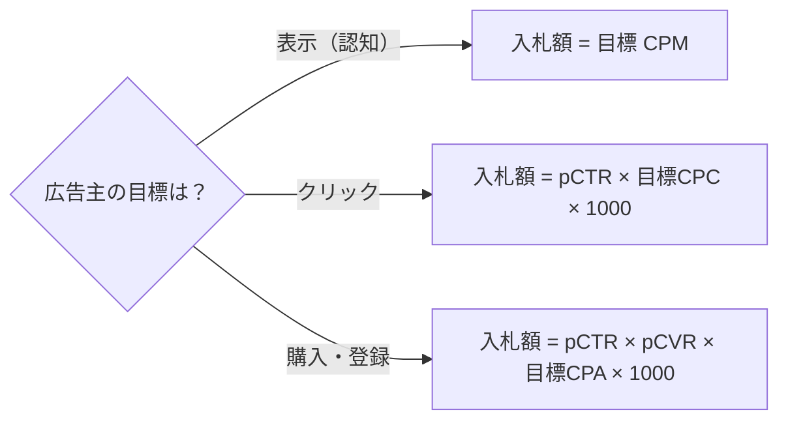
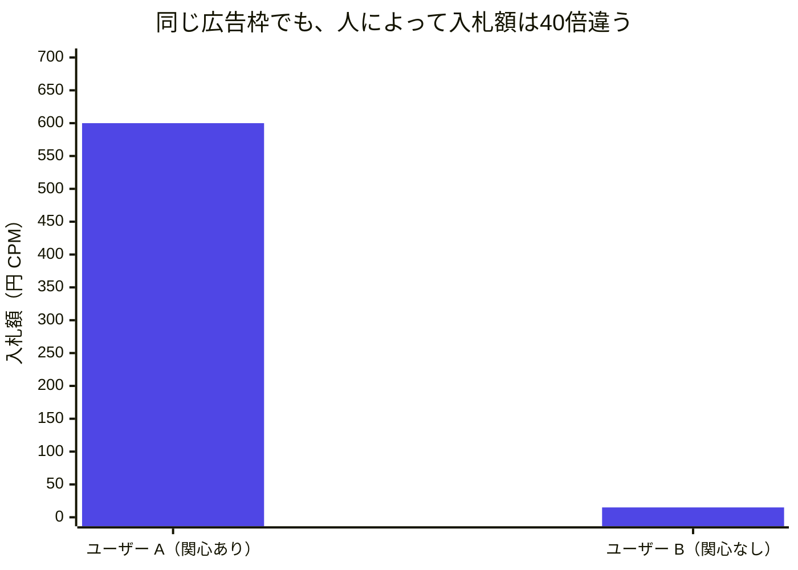
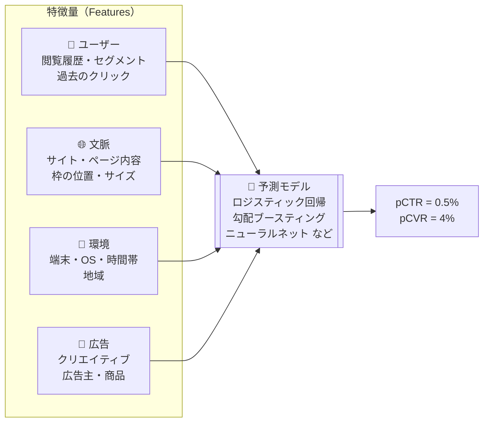
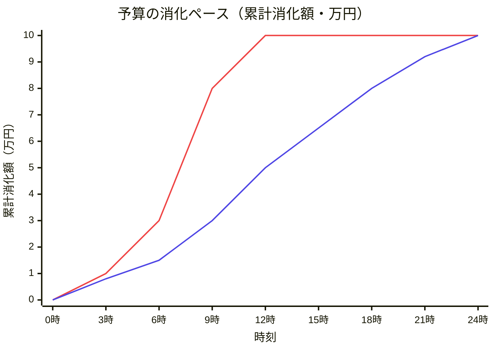
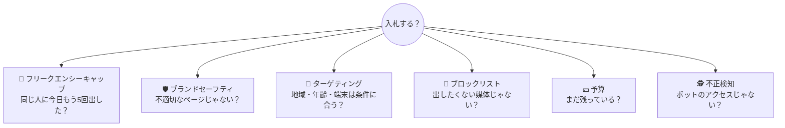
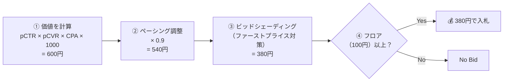

# 第5章 DSP の入札ロジック

> **この章のゴール**: DSP が「いくらで入札するか」をどう計算しているか、その基本の考え方を理解する。

## 5.1 入札額は「このインプレッションの価値」

DSP の基本的な考え方はシンプルです。

> **このインプレッション 1 回の価値はいくらか？ → それを CPM（×1000）に直して入札する**

広告主の目標が **クリック** なのか **購入** なのかで、計算式が変わります。

- **pCTR**（predicted CTR）: この人がこの広告を **クリックする確率** の予測値
- **pCVR**（predicted CVR）: クリックした人が **購入などに至る確率** の予測値

## 5.2 計算してみよう

スニーカーの EC サイトが「**1件の購入に 3,000円 まで払える**（目標 CPA = 3,000円）」というキャンペーンを出しているとします。

### ユーザー A: 昨日スニーカーのページを見た人
- pCTR = 0.5%（0.005）
- pCVR = 4%（0.04）

$$
\text{入札額} = 0.005 \times 0.04 \times 3000 \times 1000 = \textbf{600 円 CPM}
$$

### ユーザー B: 特に関係なさそうな人
- pCTR = 0.1%（0.001）
- pCVR = 0.5%（0.005）

$$
\text{入札額} = 0.001 \times 0.005 \times 3000 \times 1000 = \textbf{15 円 CPM}
$$

これが「**枠ではなく人を買う**」の具体的な意味です。

> 💡 なぜ ×1000 するの？ — 入札は CPM（1,000回表示あたりの価格）で行うためです。1回あたりの価値が 0.6円 なら、CPM では 600円 になります。

## 5.3 CTR・CVR はどう予測する？

過去の大量の配信ログから、**機械学習モデル** で予測します。

予測の難しさ:

| 課題 | 説明 |
|-----|------|
| **データの偏り** | クリック率は 0.1% 程度で、99.9% が「クリックなし」 |
| **速度** | 1件あたり数 ms 以内で予測しないといけない |
| **コンバージョンの遅れ** | 購入は広告を見た数日後に起きることもあり、正解データがすぐ揃わない |
| **確率の正確さ（キャリブレーション）** | 入札額に直接使うので、順位だけでなく「確率の値そのもの」が正確である必要がある |

## 5.4 予算ペーシング

1日の予算が 10万円 のキャンペーンがあるとします。何も工夫しないと…

- **上の線（工夫なし）**: 朝のうちに予算を使い切り、夜のゴールデンタイムに広告が出ない 😢
- **下の線（ペーシングあり）**: アクセス量に合わせて1日を通して均等に消化 😊

DSP は **ペーシング** で予算の使い方を調整します。

| 方法 | 仕組み |
|-----|-------|
| **スロットリング** | 一定の確率で入札自体をスキップする（入札する割合を調整） |
| **入札額の調整** | 入札額に係数をかけて、勝ちすぎ・負けすぎを調整する |

## 5.5 その他の入札判断

## 5.6 最終的な入札額の流れ

---

⬅️ 前へ: [第4章 オークション方式](04-auction.md) ｜ ➡️ 次へ: [第6章 取引形態](06-deals.md)
