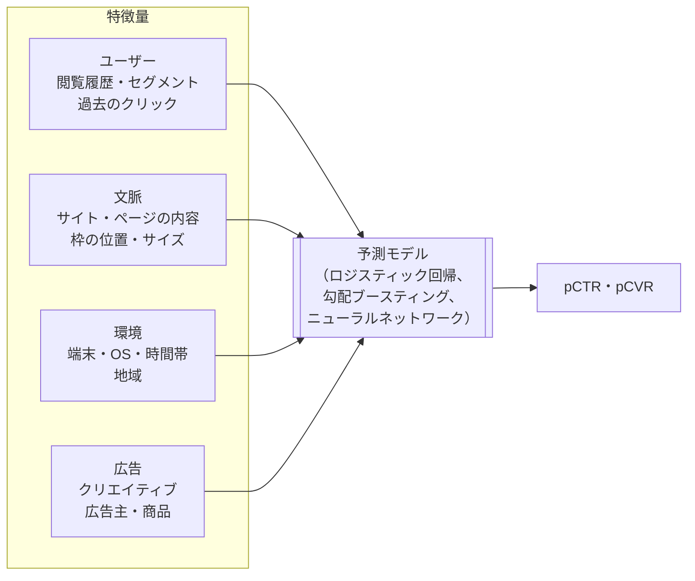
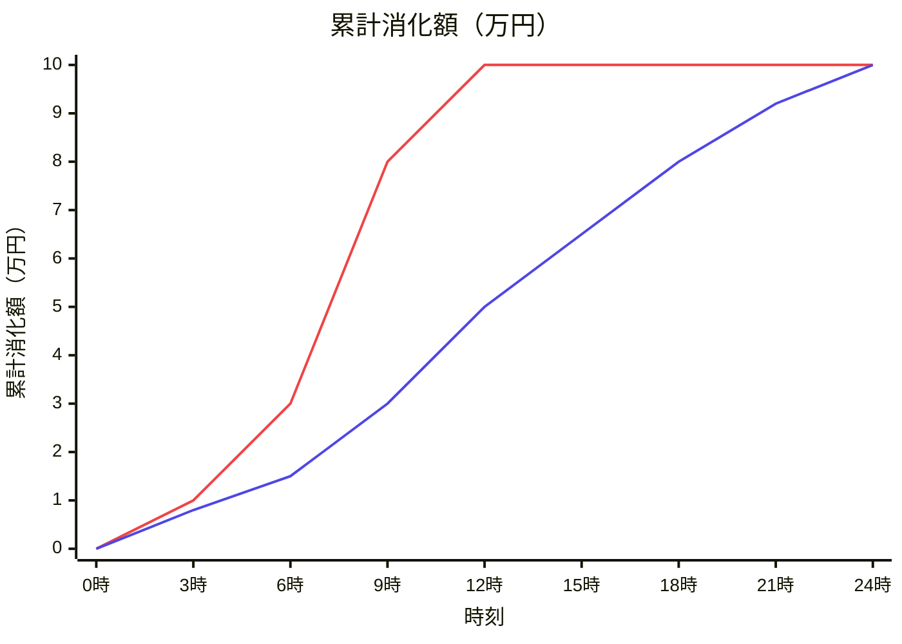
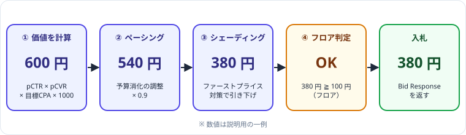

# 第5章 DSP の入札ロジック

DSP は、1 回のインプレッションにいくら払うべきかを数十ミリ秒で決めなければなりません。本章では、その計算の基本となる考え方を、具体的な数値を使って説明します。

!!! abstract "この章で学ぶこと"

    - 広告主の目標（表示・クリック・成果）に応じた入札額の計算式
    - CTR・CVR を予測する機械学習モデルの役割と難しさ
    - 予算ペーシングなど、入札額に影響するその他の判断

## 5.1 入札額は「インプレッションの価値」

DSP の基本的な考え方は単純です。

> **このインプレッション 1 回にどれだけの価値があるかを見積もり、それを CPM（1,000 回あたり）に換算して入札する。**

広告主の目標が表示なのか、クリックなのか、購入などの成果なのかによって、計算式が変わります。

| 広告主の目標 | 入札額（CPM）の計算式 |
|------------|---------------------|
| 表示（認知の獲得） | 目標 CPM |
| クリック | $\text{pCTR} \times \text{目標 CPC} \times 1000$ |
| 成果（購入・登録など） | $\text{pCTR} \times \text{pCVR} \times \text{目標 CPA} \times 1000$ |

- **pCTR**（predicted CTR）：このユーザーがこの広告を**クリックする確率**の予測値
- **pCVR**（predicted CVR）：クリックしたユーザーが**成果に至る確率**の予測値

!!! question "なぜ 1000 を掛けるのか"

    入札は CPM（1,000 回表示あたりの価格）で行うためです。1 回の表示の価値が 0.6 円なら、CPM に換算すると 600 円になります。

## 5.2 計算例

スニーカーの EC サイトが「**購入 1 件あたり 3,000 円まで払える**」（目標 CPA = 3,000 円）というキャンペーンを出しているとします。

**ユーザー A：前日にこの EC サイトでスニーカーの商品ページを見た人**

pCTR を 0.5%、pCVR を 4% と予測した場合は、次のようになります。

$$
\text{入札額} = 0.005 \times 0.04 \times 3000 \times 1000 = 600 \text{ 円}
$$

**ユーザー B：スニーカーへの関心が見られない人**

pCTR を 0.1%、pCVR を 0.5% と予測した場合は、次のようになります。

$$
\text{入札額} = 0.001 \times 0.005 \times 3000 \times 1000 = 15 \text{ 円}
$$

同じ広告枠でも、閲覧しているユーザーによって入札額は 40 倍も違います。これが第1章で述べた「**枠ではなく人を買う**」の具体的な意味です。

## 5.3 CTR と CVR の予測

pCTR や pCVR は、過去の大量の配信記録から学習した**機械学習モデル**で予測します。

図5-1　CTR・CVR 予測モデルの入力と出力

予測には、次のような難しさがあります。

| 課題 | 内容 |
|-----|------|
| **極端な不均衡** | クリック率は 0.1% 程度のことも多く、学習データのほとんどが「クリックなし」である |
| **速度の制約** | 1 件あたり数ミリ秒で予測を終える必要がある |
| **成果の遅れ** | 購入は広告を見た数日後に起きることもあり、正解データがすぐにはそろわない |
| **確率の正確さ** | 予測値をそのまま入札額の計算に使うため、順位だけでなく確率の値そのものが正確でなければならない（キャリブレーション） |

## 5.4 予算ペーシング

1 日の予算が 10 万円のキャンペーンで、何も工夫せずに入札するとどうなるでしょうか。

図5-2　予算の消化ペース。赤：調整なし、青：ペーシングあり（説明用の例）

- **調整なし（赤）**：昼までに予算を使い切り、夜の時間帯に広告が出せない
- **ペーシングあり（青）**：アクセス量に合わせて 1 日を通して予算を消化する

DSP は、次のような方法で予算の使い方を調整します。

| 方法 | 仕組み |
|-----|-------|
| **スロットリング** | 一定の確率で入札そのものを見送り、入札する割合を調整する |
| **入札額の調整** | 入札額に係数を掛けて、勝ちすぎや負けすぎを調整する |

## 5.5 入札額以外の判断

入札額を計算する前後で、DSP は次のような条件も確認します。

| 確認項目 | 内容 |
|---------|------|
| **フリークエンシーキャップ** | 同じユーザーに、決められた回数以上広告を表示していないか |
| **ブランドセーフティ** | 不適切なページではないか |
| **ターゲティング** | 地域・年齢・端末などの条件に合うか |
| **ブロックリスト** | 広告主が避けたい媒体ではないか |
| **予算** | 予算が残っているか |
| **不正検知** | ボットによるアクセスではないか |

## 5.6 入札額が決まるまで

ここまでの要素を組み合わせると、入札額は次のように決まります。

<figure markdown="span">
  { width="760" }
  <figcaption>図5-3　DSP が入札額を決めるまでの流れ（数値は説明用の例）</figcaption>
</figure>

!!! success "この章のまとめ"

    - DSP は、インプレッション 1 回の価値を見積もって CPM に換算し、入札額とする
    - 成果目標の場合の入札額は「pCTR × pCVR × 目標 CPA × 1000」で求められる
    - pCTR・pCVR の予測精度、特に確率値の正確さが入札の質を左右する
    - ペーシングやビッドシェーディングなどの調整を経て、最終的な入札額が決まる
