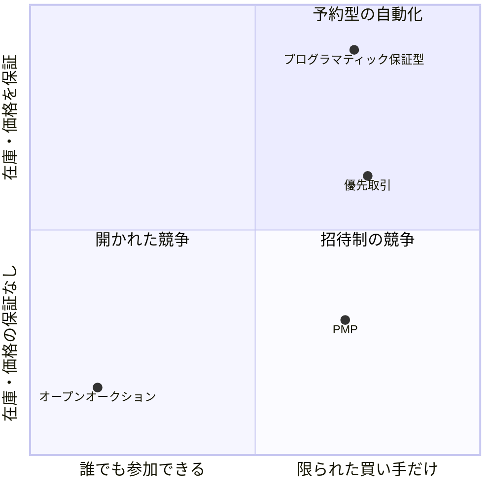
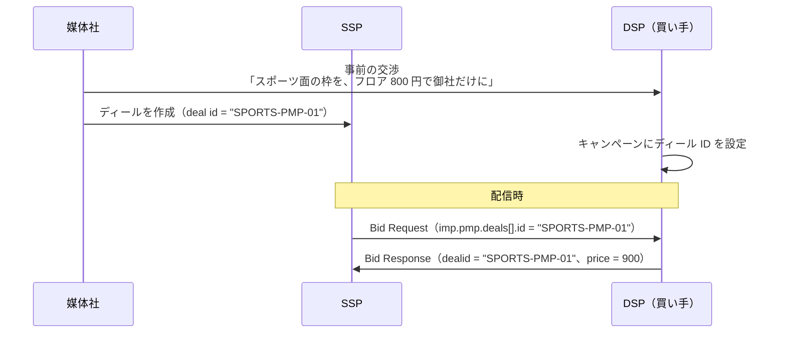
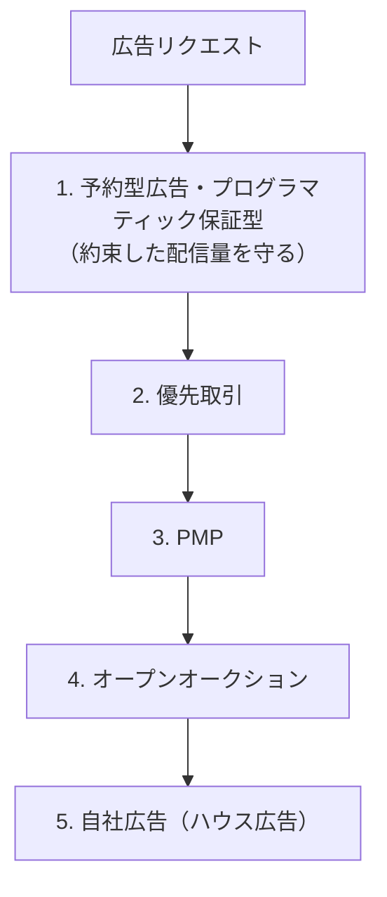

# 第6章 取引形態

プログラマティック広告の取引は、誰でも参加できるオークションだけではありません。本章では、参加者や価格の決め方が異なる 4 つの取引形態と、それを実現するディール ID の仕組みを説明します。

!!! abstract "この章で学ぶこと"

    - オープンオークション、PMP、優先取引、プログラマティック保証型の違い
    - ディール ID が Bid Request と Bid Response の中でどう扱われるか
    - 広告主と媒体社がディール取引を選ぶ理由

## 6.1 4 つの取引形態

取引形態は、「**誰が参加できるか**」と「**在庫や価格が保証されるか**」の 2 つの軸で整理できます。


<p class="figcap">図6-1　取引形態の位置づけ</p>

| 取引形態 | 参加者 | 価格の決め方 | 在庫の保証 | オークション |
|---------|-------|-----|----------|------------|
| **オープンオークション** | 誰でも | 入札で決まる | なし | あり |
| **PMP**（Private Marketplace） | 招待された買い手 | 入札で決まる（フロアあり） | なし | あり |
| **優先取引**（Preferred Deal） | 特定の 1 社 | 固定 | なし（買い手は買わないこともできる） | なし |
| **プログラマティック保証型**（Programmatic Guaranteed, PG） | 特定の 1 社 | 固定 | **あり**（買い手は原則として全量を買う） | なし |

## 6.2 レストランの席にたとえる

| 取引形態 | たとえ |
|---------|-------|
| オープンオークション | 空いた席を、当日その場で一番高い値を付けた客に売る |
| PMP | 会員だけが参加できる席のオークション |
| 優先取引 | 常連客に「この値段で空いています」と先に声をかける |
| プログラマティック保証型 | 1 か月前に「この日に 20 席をこの値段で」と予約を確定する |

## 6.3 ディール ID の仕組み

PMP や優先取引などの取引は、**ディール ID** を使って実現します。媒体社と買い手が事前に条件を合意します。SSP は、合意した条件を満たす Bid Request にディール ID を付けて DSP へ送ります。


<p class="figcap">図6-2　ディール取引の流れ</p>

Bid Request の中では、次のように表現されます[^openrtb26]。

```json
"pmp": {
  "private_auction": 1,
  "deals": [
    { "id": "SPORTS-PMP-01", "bidfloor": 800, "bidfloorcur": "JPY", "at": 1 }
  ]
}
```

| フィールド | 意味 |
|-----------|------|
| `private_auction: 1` | ディールを持つ買い手だけが入札できる |
| `private_auction: 0` | ディールのない通常の入札も受け付ける |
| `deals[].bidfloor` | そのディールでの最低落札価格 |
| `deals[].at` | そのディールでのオークション方式 |

## 6.4 アドサーバーでの優先順位

媒体社のアドサーバーは、一般に次のような優先順位で表示する広告を決めます。


<p class="figcap">図6-3　アドサーバーでの優先順位の一例</p>

実際には、2 以降は価格で横並びに比較されることも多く、媒体社の設定によって異なります。

## 6.5 ディール取引が選ばれる理由

| 立場 | オープンオークションでの不満 | ディール取引による解決 |
|-----|----------------------|-------------|
| 広告主 | どのようなサイトに表示されるか分からない | 信頼できる媒体だけに配信できる |
| 広告主 | 質の高い枠を確実に買いたい | 優先的に買える |
| 媒体社 | 安く買いたたかれる | 高い価格で売れる |
| 媒体社 | 売上の見通しが立たない | 保証型なら売上が確定する |

!!! success "この章のまとめ"

    - 取引形態は「参加者が限られるか」と「在庫・価格が保証されるか」で 4 つに分けられる
    - PMP や優先取引は、Bid Request の `imp.pmp.deals` に載るディール ID で実現される
    - ディール取引は、広告主には媒体の品質と確実性を、媒体社には価格と売上の見通しをもたらす

[^openrtb26]: IAB Tech Lab, *OpenRTB 2.6*, 2022–. <https://github.com/InteractiveAdvertisingBureau/openrtb2.x/blob/main/2.6.md>
