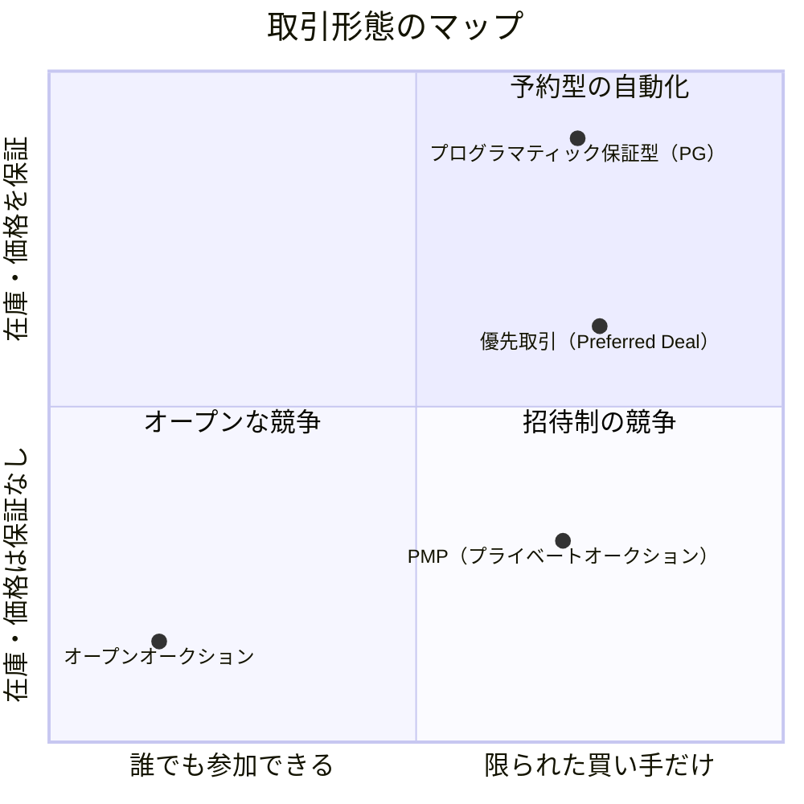
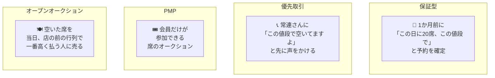
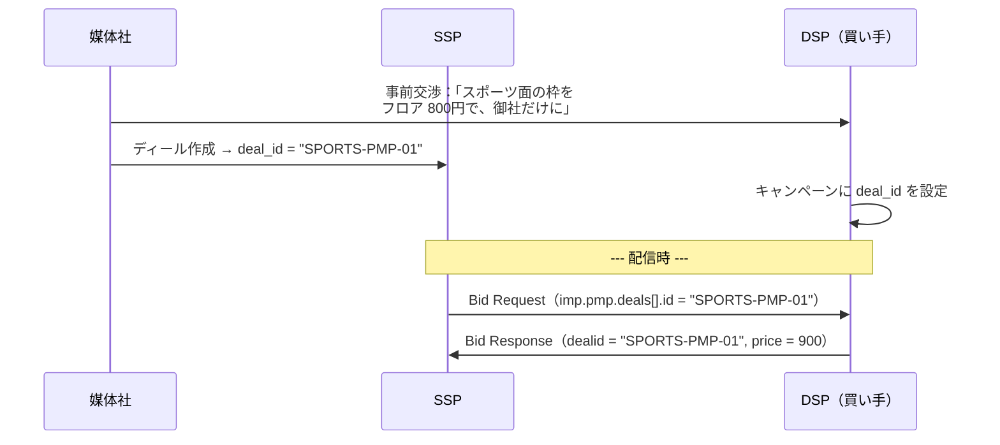
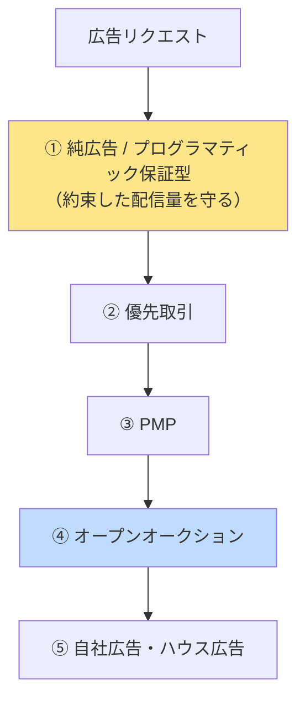

# 第6章 取引形態 — オープンオークションだけじゃない

> **この章のゴール**: オープンオークション・PMP・プログラマティック保証型の違いを説明できるようになる。

## 6.1 取引形態の全体像

プログラマティック広告には、「**誰でも参加できるか**」と「**在庫や価格が保証されるか**」の2軸で、いくつかの取引形態があります。



| 取引形態 | 参加者 | 価格 | 在庫の保証 | オークション |
|---------|-------|-----|----------|------------|
| **オープンオークション** | 誰でも | 入札で決定 | なし | あり |
| **PMP**（Private Marketplace） | 招待された買い手 | 入札で決定（フロアあり） | なし | あり |
| **優先取引**（Preferred Deal） | 特定の1社 | 固定 | なし（買い手は断れる） | なし |
| **プログラマティック保証型**（PG） | 特定の1社 | 固定 | **あり**（買い手は原則全量買う） | なし |

## 6.2 たとえ話：レストランの予約



## 6.3 ディール ID の仕組み

PMP や優先取引は、**ディール ID**（Deal ID）を使って実現されます。
媒体社と買い手が事前に条件を合意し、その条件に合う Bid Request に **ディール ID を付けて** 送ります。



Bid Request 内ではこう表現されます:

```json
"pmp": {
  "private_auction": 1,
  "deals": [
    { "id": "SPORTS-PMP-01", "bidfloor": 800, "bidfloorcur": "JPY", "at": 1 }
  ]
}
```

- `private_auction: 1` → ディールを持つ買い手だけが入札できる
- `private_auction: 0` → ディール以外の通常入札も受け付ける

## 6.4 アドサーバーでの優先順位

媒体社のアドサーバーは、だいたい次のような順番で広告を決めます。



実際には、② 以降は価格で横並びに比べられることも多く、媒体社の設定によって変わります。

## 6.5 なぜ PMP や保証型を使うの？

| 立場 | オープンオークションの不満 | ディールで解決 |
|-----|----------------------|-------------|
| 広告主 | どんなサイトに出るか不安 | **信頼できる媒体** だけに出せる |
| 広告主 | 良い枠を確実に買いたい | **優先的に** 買える |
| 媒体社 | 安く買い叩かれる | **プレミアム価格** で売れる |
| 媒体社 | 売上の見通しが立たない | 保証型なら **売上が確定** |

---

⬅️ 前へ: [第5章 DSP の入札ロジック](05-dsp-bidding.md) ｜ ➡️ 次へ: [第7章 プライバシーと識別子](07-privacy.md)
