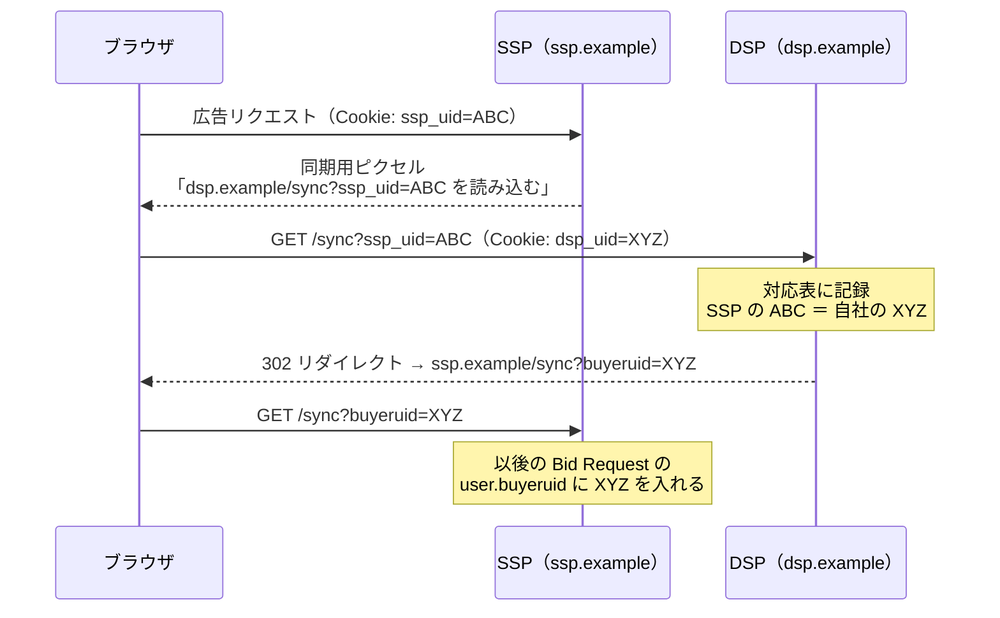
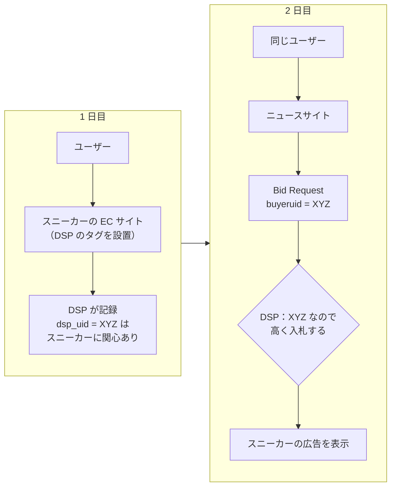
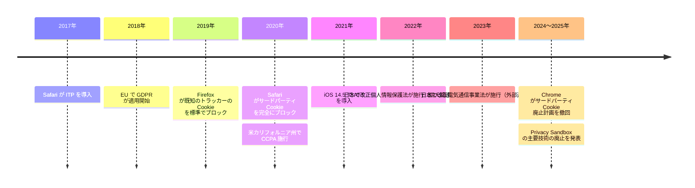
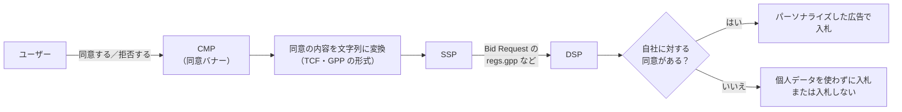

# 第7章 プライバシーと識別子

「人を買う」RTB は、異なるサイトにいる同じユーザーを識別できることを前提に発展してきました。本章では、その識別の仕組みと、プライバシー保護の強化によって何が変わったのかを説明します。

!!! abstract "この章で学ぶこと"

    - RTB で使われる識別子の種類と、Cookie Sync の仕組み
    - ブラウザ・OS・法規制によるプライバシー保護の流れと、2025 年時点の Chrome の状況
    - 同意管理（TCF・GPP）と、Cookie に頼らない広告手法

!!! warning "情報の鮮度について"

    本章の内容は、ブラウザの仕様や法規制の変更によって短期間で古くなるおそれがあります。本書は 2026 年 11 月時点の情報に基づいています。実務で利用する際は、脚注の一次情報で最新の状況を確認してください。

## 7.1 同じ人を見分ける識別子

RTB で「前日にスニーカーを見た人」に広告を出すには、**別々のサイトにいる同じ人を結びつける**必要があります。そのために使われてきたのが、次のような**識別子（ID）**です。

| 識別子 | 使われる場所 | 仕組み |
|-------|-----------|-------|
| **サードパーティ Cookie** | Web ブラウザ | アドテク事業者のドメインで発行され、多くのサイトをまたいで読み取れる ID |
| **ファーストパーティ Cookie** | Web ブラウザ | 訪問したサイト自身が発行する ID。原則としてそのサイト内でのみ使える |
| **広告 ID**（IDFA / GAID） | スマートフォンのアプリ | OS が発行する端末ごとの ID。iOS では IDFA、Android では GAID |
| **共通 ID**（UID2、ID5 など） | Web・アプリ・CTV | メールアドレスのハッシュ値などをもとに作り、業界で共有する ID |

## 7.2 Cookie Sync

SSP と DSP は、それぞれ**別の Cookie ID** でユーザーを管理しています。同じユーザーだと分かるように、両者の **ID の対応表**を作る仕組みが Cookie Sync（クッキーシンク）です。


<p class="figcap">図7-1　Cookie Sync の流れ</p>

この対応づけによって、DSP は Bid Request の `user.buyeruid = XYZ` を見て、「自社の広告主のサイトを訪れたことがあるユーザーだ」と判断できます。

## 7.3 リターゲティングの仕組み


<p class="figcap">図7-2　リターゲティングの仕組み</p>

## 7.4 プライバシー保護の流れ

サードパーティ Cookie は便利な反面、**本人が気づかないうちにサイトをまたいで行動を追跡できる**ため、ブラウザ・OS・法規制の各方面で対策が進みました。


<p class="figcap">図7-3　プライバシー保護に関する主な出来事</p>

### ブラウザと OS の状況（2026 年 11 月時点）

| 環境 | サードパーティ Cookie・広告 ID の扱い |
|-----|------------------------------|
| Safari | サードパーティ Cookie を標準で完全にブロック（2020 年から）[^webkit] |
| Firefox | 既知のトラッカーの Cookie を標準でブロックし、それ以外のサードパーティ Cookie はサイトごとに分離（Total Cookie Protection） |
| Chrome | 通常のウィンドウでは**引き続き利用できる**。シークレットモードでは標準でブロック |
| iOS アプリ | ATT により、IDFA は**ユーザーが許可した場合のみ**取得できる |
| Android アプリ | GAID を利用できる（ユーザーは削除や無効化が可能） |

### Chrome の方針転換

Chrome は長年、サードパーティ Cookie の段階的な廃止と、その代わりとなる **Privacy Sandbox**（Topics API、Protected Audience API など）の導入を進めてきました。しかしその後、方針を大きく転換しています[^chrome2025a][^chrome2025b]。

| 時期 | 出来事 |
|-----|-------|
| 2024 年 1 月 | 一部のユーザー（約 1%）でサードパーティ Cookie を制限するテストを開始 |
| 2024 年 7 月 | サードパーティ Cookie の廃止計画を撤回し、ユーザーの選択に委ねる方針を発表 |
| 2025 年 4 月 | ユーザーに選択を求める独立したプロンプトも導入せず、現行の方式を維持すると発表 |
| 2025 年 10 月 | Topics API、Protected Audience API、Attribution Reporting API など、Privacy Sandbox の主要技術の廃止を発表 |

!!! note "日本の法規制"

    - **改正個人情報保護法（2022 年 4 月施行）**：Cookie などの「個人関連情報」を、提供先で個人データとして取得されることが想定される場合に第三者へ提供するときは、本人の同意が得られていることの確認が必要になりました[^ppc]。
    - **改正電気通信事業法（2023 年 6 月施行）**：利用者の端末から外部へ情報を送信させるタグなどについて、送信される情報や送信先を利用者に通知・公表することなどが求められるようになりました（外部送信規律）[^soumu]。

## 7.5 同意管理

GDPR などのもとでは、広告目的で個人データを扱うには、多くの場合ユーザーの**同意**が必要です。Web サイトでよく見る「Cookie の使用に同意しますか」というバナーは、**CMP**（Consent Management Platform）が表示しています。


<p class="figcap">図7-4　同意情報が DSP に届くまで</p>

| 仕組み | 主な対象地域 | 内容 |
|-------|-----|------|
| **TCF**（Transparency & Consent Framework） | 欧州 | IAB Europe が定める同意情報の形式 |
| **GPP**（Global Privacy Platform） | 欧州・米国など | 複数の地域の規制に対応する同意情報を 1 つの形式で扱える IAB Tech Lab の仕様 |

OpenRTB 2.6 では、GPP の文字列を `regs.gpp` に、適用されるセクションの ID を `regs.gpp_sid` に入れます。たとえば EU のユーザーに TCF を適用する場合は、次のようになります（セクション ID の 2 は EU TCF v2 を表します）[^gpp]。

```json
"regs": {
  "gpp": "（CMP が生成した GPP 文字列）",
  "gpp_sid": [2]
}
```

## 7.6 Cookie に頼らない広告手法

| 手法 | 内容 |
|-----|------|
| **コンテキスト広告** | ページの内容に合わせて広告を出す。サッカーの記事にスポーツ用品の広告を出すなど |
| **ファーストパーティデータ** | 媒体社が持つログイン会員の情報や、広告主が持つ顧客データを活用する |
| **共通 ID** | UID2 や ID5 など、メールアドレスのハッシュ値などから作る ID を使う |
| **データクリーンルーム** | 生のデータを互いに渡さずに、広告主と媒体社のデータを安全に突き合わせる |
| **セラー定義オーディエンス** | 媒体社が作ったユーザーセグメントを、個人を特定しない形で買い手に渡す |

コンテキスト広告は「誰が見ているか」ではなく「**何を見ているか**」で広告を決めるため、個人を追跡しません。AI による文章や画像の理解が進んだことで、近年あらためて注目されています。

!!! success "この章のまとめ"

    - RTB はサードパーティ Cookie・広告 ID・共通 ID などでユーザーを識別し、Cookie Sync で ID を対応づけてきた
    - Safari・Firefox・iOS では追跡が大きく制限された一方、Chrome はサードパーティ Cookie の廃止を撤回した
    - 欧州などでは同意管理が必須であり、同意情報は TCF・GPP の形式で Bid Request に載る
    - コンテキスト広告やファーストパーティデータなど、Cookie に頼らない手法の重要性が増している

[^webkit]: WebKit, "Full Third-Party Cookie Blocking and More", 2020. <https://webkit.org/blog/10218/full-third-party-cookie-blocking-and-more/>
[^chrome2025a]: Google, "Next steps for Privacy Sandbox and tracking protections in Chrome", 2025. <https://privacysandbox.google.com/blog/privacy-sandbox-next-steps>
[^chrome2025b]: Google, "Update on Plans for Privacy Sandbox Technologies", 2025. <https://privacysandbox.google.com/blog/update-on-plans-for-privacy-sandbox-technologies>
[^ppc]: 個人情報保護委員会. <https://www.ppc.go.jp/>
[^soumu]: 総務省「外部送信規律」. <https://www.soumu.go.jp/main_sosiki/joho_tsusin/d_syohi/gaibusoushin_kiritsu.html>
[^gpp]: IAB Tech Lab, *Global Privacy Platform: Section Information*. <https://github.com/InteractiveAdvertisingBureau/Global-Privacy-Platform/blob/main/Sections/Section%20Information.md>
