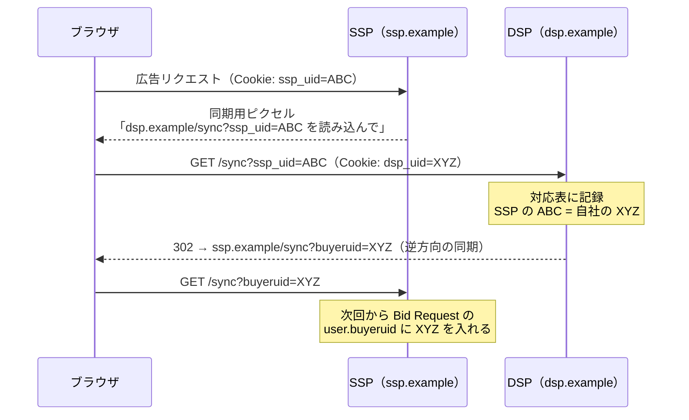
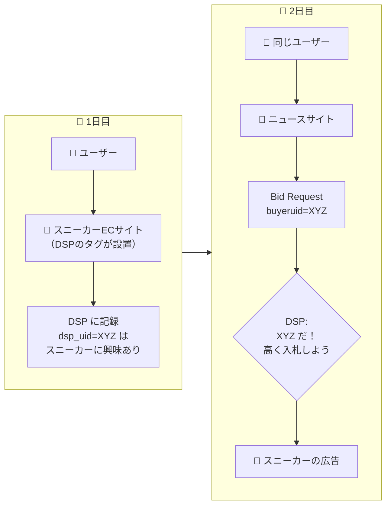
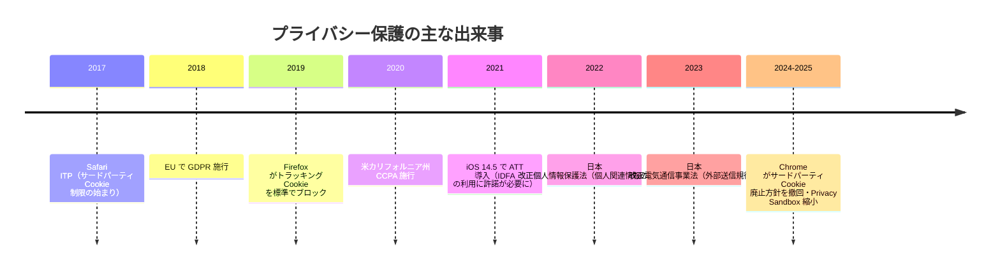
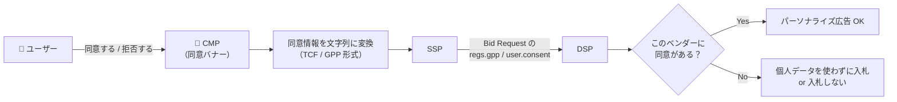
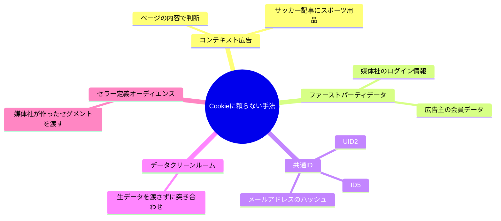

# 第7章 プライバシーと識別子

> **この章のゴール**: RTB で「人」を識別する仕組みと、それがプライバシー規制でどう変わってきたかを理解する。

## 7.1 「同じ人」をどうやって見分ける？

RTB で「昨日スニーカーを見た人」に広告を出すには、**別々のサイトにいる同じ人を結びつける** 必要があります。そのために使われてきたのが **識別子（ID）** です。

| 識別子 | 使われる場所 | 仕組み |
|-------|-----------|-------|
| **サードパーティ Cookie** | Web ブラウザ | アドテク企業のドメインで発行され、どのサイトでも読める ID |
| **ファーストパーティ Cookie** | Web ブラウザ | 訪問したサイト自身が発行する ID（そのサイト内でのみ有効） |
| **広告 ID**（IDFA / GAID） | スマホアプリ | OS が発行する端末ごとの ID（iOS: IDFA、Android: GAID） |
| **共通 ID**（UID2, ID5 など） | Web / アプリ / CTV | メールアドレスのハッシュなどから作る、業界で共有される ID |

## 7.2 Cookie Sync（クッキーシンク）

SSP と DSP は、それぞれ **別の Cookie ID** でユーザーを管理しています。
同じユーザーだと分かるように、**ID の対応表** を作る仕組みが Cookie Sync です。

これで DSP は Bid Request の `user.buyeruid = XYZ` を見て、「**うちのサイトに来たことがある、あの人だ！**」と分かります。

## 7.3 リターゲティングの仕組み

## 7.4 プライバシー規制の流れ

サードパーティ Cookie は便利な反面、**本人の知らないうちにサイトをまたいで行動を追跡** できてしまうため、各国の規制やブラウザ・OS の対応が進みました。

### ブラウザ・OS の状況

| 環境 | サードパーティ Cookie / 広告 ID |
|-----|------------------------------|
| Safari（iPhone の標準ブラウザ） | 標準でブロック |
| Firefox | 標準でブロック |
| Chrome | **現在も利用可能**（廃止方針は撤回された） |
| iOS アプリ | IDFA は ATT で **ユーザーが許可した場合のみ** |
| Android アプリ | GAID は利用可能（ユーザーが削除・無効化可能） |

> ⚠️ Chrome は長年サードパーティ Cookie の段階的廃止と、その代替となる **Privacy Sandbox**（Topics API、Protected Audience API など）を進めていましたが、2024〜2025年に方針を転換し、廃止を見送りました。Privacy Sandbox の多くの API も縮小・廃止の方向と発表されています。
> この分野は変化が激しいので、**最新の公式発表を確認** してください。

## 7.5 同意管理（Consent）

GDPR などでは、広告目的でデータを使うには **ユーザーの同意** が必要です。
サイトでよく見る「Cookie を受け入れますか？」のバナーは **CMP**（Consent Management Platform）が表示しています。

| 仕組み | 地域 | 内容 |
|-------|-----|------|
| **TCF**（Transparency & Consent Framework） | 欧州 | IAB Europe の同意情報フォーマット |
| **GPP**（Global Privacy Platform） | 米国ほか | 複数地域の規制を1つの形式で扱える IAB Tech Lab の仕様 |

## 7.6 Cookie に頼らない広告手法

**コンテキスト広告** は「誰が」ではなく「**何を見ているか**」で広告を決めるため、個人を追跡しません。
AI による文章・画像の理解が進んだことで、近年あらためて注目されています。

---

⬅️ 前へ: [第6章 取引形態](06-deals.md) ｜ ➡️ 次へ: [第8章 透明性・品質・不正対策](08-quality-fraud.md)
