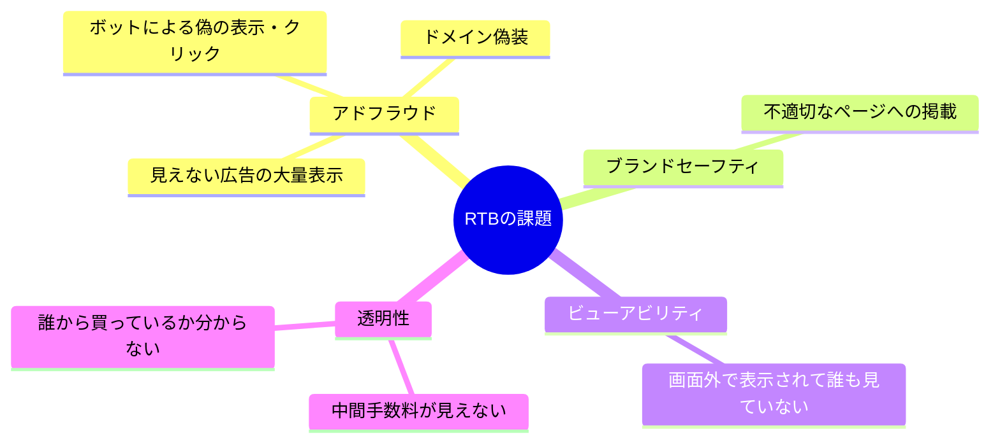
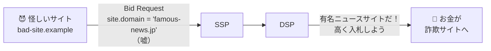
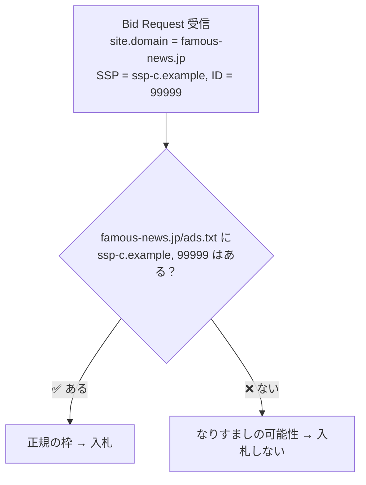
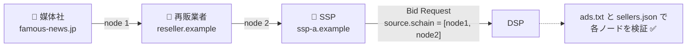
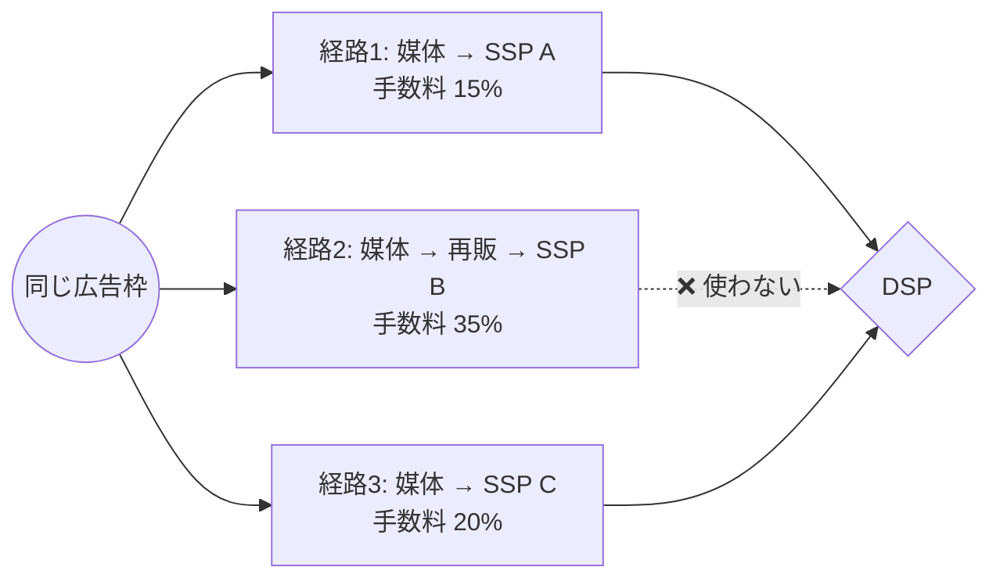
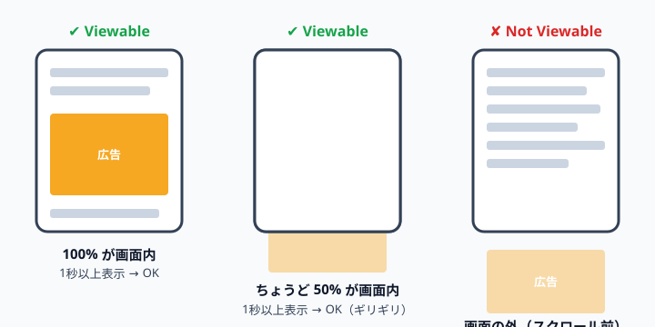

# 第8章 透明性・品質・不正対策

> **この章のゴール**: 「本物の枠に、本物の人が、ちゃんと見られる状態で」広告を出すための仕組みを理解する。

## 8.1 RTB の「闇」

自動化された取引は便利な反面、**人の目が届かない** ことで様々な問題が起きます。



## 8.2 アドフラウド（広告詐欺）

| 手口 | 内容 |
|-----|------|
| **ボットトラフィック** | プログラムが人間のふりをしてページを見たり、クリックしたりする |
| **ドメインスプーフィング** | 怪しいサイトが「有名ニュースサイト」を名乗って Bid Request を送る |
| **広告スタッキング** | 広告を何枚も重ねて、見えている1枚以外も表示したことにする |
| **ピクセルスタッフィング** | 1×1 ピクセルの見えない枠に広告を詰め込む |
| **アプリのなりすまし** | 人気アプリの ID を名乗って枠を売る |

### ドメインスプーフィングの例



## 8.3 ads.txt — 「正規の販売者」を公開する

**ads.txt** は、媒体社が **「うちの広告枠を売っていいのはこの会社だけです」** と自分のサイトに公開するテキストファイルです（2017年、IAB Tech Lab）。

```text
# https://famous-news.jp/ads.txt
ssp-a.example, 12345, DIRECT, abc123
ssp-b.example, 67890, RESELLER
```

| 列 | 意味 |
|---|-----|
| 1 | SSP のドメイン |
| 2 | その SSP での媒体社のアカウント ID |
| 3 | `DIRECT`（媒体社が直接契約）/ `RESELLER`（再販業者経由） |
| 4 | （任意）認証機関の ID |



アプリ版は **app-ads.txt** です。

## 8.4 sellers.json と SupplyChain Object

ads.txt が「**媒体社側からの宣言**」なのに対し、

- **sellers.json**: SSP が「**うちのアカウント ID 12345 は famous-news.jp です**」と公開するファイル
- **SupplyChain Object（schain）**: Bid Request に含まれる「**この枠がここまで通ってきた経路**」の記録



この3つを組み合わせることで、DSP は「**本当にその媒体の枠を、正規のルートで買っているか**」を確認できます。

## 8.5 SPO（Supply Path Optimization）

同じ枠が複数の経路で売られている場合、DSP（や広告主）は **最も効率の良い経路だけ** を使うようにします。



手数料が少ないほど、広告主が払ったお金のうち **媒体社に届く割合** が増えます。

## 8.6 ビューアビリティ — 「見られた」の基準

広告が「表示された」としても、ページの下の方にあって **ユーザーがスクロールしなければ誰も見ていない** かもしれません。
そこで、業界団体 MRC は **「見られた（Viewable）」とみなす基準** を定めています。

| 広告の種類 | 基準 |
|----------|-----|
| ディスプレイ広告 | 広告の面積の **50% 以上** が画面内に **連続 1 秒以上** |
| 動画広告 | 広告の面積の **50% 以上** が画面内で **連続 2 秒以上** 再生 |
| 大型ディスプレイ広告（242,500 ピクセル以上） | 面積の **30% 以上** が連続 1 秒以上 |



## 8.7 ブランドセーフティ

広告主は、自社の広告が **不適切なページ**（暴力・アダルト・フェイクニュースなど）に表示されるとブランドイメージが傷つきます。

対策:
- Bid Request の `bcat`（ブロックカテゴリ）・`badv`（ブロック広告主）による **媒体側のブロック**
- DSP 側の **ブロックリスト / 許可リスト**（ホワイトリスト）
- 第三者ツールによる **ページ内容の解析**（入札前・配信時）

---

⬅️ 前へ: [第7章 プライバシーと識別子](07-privacy.md) ｜ ➡️ 次へ: [第9章 指標と計算式](09-metrics.md)
