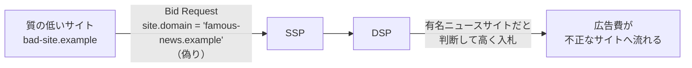
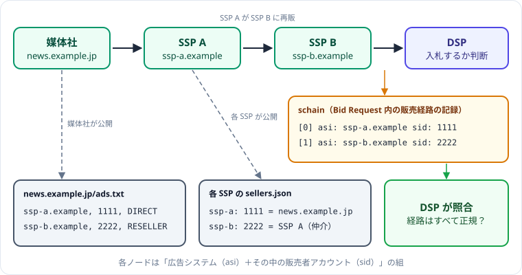
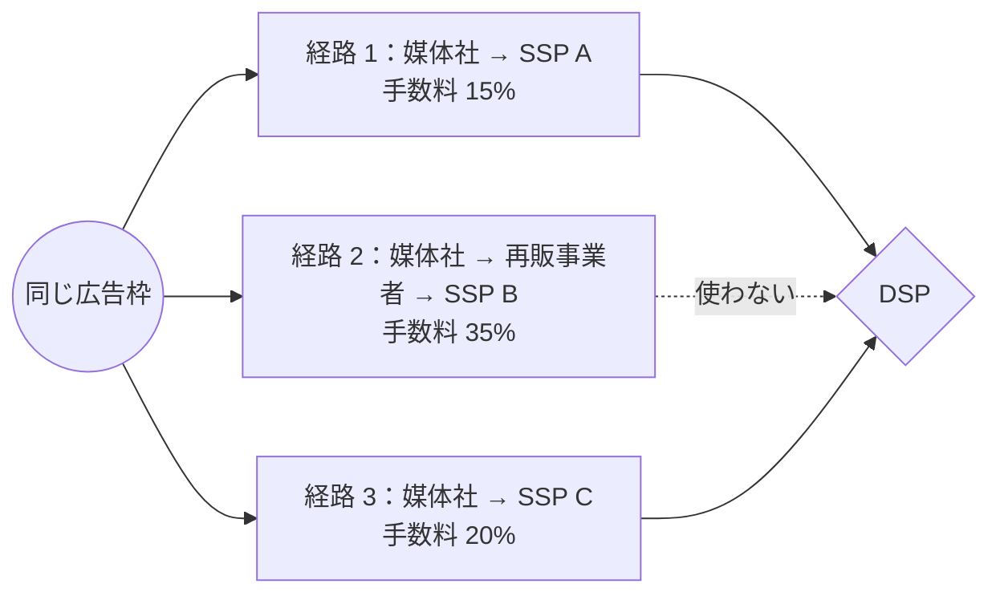

# 第8章 透明性・品質・不正対策

自動化された取引は効率的な一方で、人の目が届きにくくなります。本章では、「**正規の広告枠に、実在する人に、実際に見える状態で**」広告を届けるための仕組みを説明します。

!!! abstract "この章で学ぶこと"

    - アドフラウド（広告詐欺）の代表的な手口
    - ads.txt・sellers.json・SupplyChain Object による販売経路の検証
    - SPO、ビューアビリティ、ブランドセーフティの考え方

## 8.1 RTB が抱える課題

| 課題 | 内容 |
|-----|------|
| **アドフラウド** | ボットによる偽の表示やクリック、媒体のなりすましなどで広告費をだまし取る |
| **ブランドセーフティ** | 広告が不適切なページに表示され、広告主のブランドが傷つく |
| **ビューアビリティ** | 広告が画面の外に表示され、誰にも見られていない |
| **透明性** | 中間事業者の手数料や、誰から買っているのかが見えにくい |

## 8.2 アドフラウド

| 手口 | 内容 |
|-----|------|
| **ボットトラフィック** | プログラムが人間のふりをしてページを閲覧したり、広告をクリックしたりする |
| **ドメインスプーフィング** | 質の低いサイトが、有名なニュースサイトを名乗って Bid Request を送る |
| **広告スタッキング** | 広告を何枚も重ねて表示し、見えている 1 枚以外も表示したことにする |
| **ピクセルスタッフィング** | 1×1 ピクセルの見えない枠に広告を詰め込む |
| **アプリのなりすまし** | 人気アプリの ID を名乗って広告枠を売る |


<p class="figcap">図8-1　ドメインスプーフィングの例</p>

## 8.3 ads.txt：正規の販売者を公開する

**ads.txt** は、媒体社が「**自社の広告枠を販売してよいのはこの事業者だけです**」と自社のドメインで公開するテキストファイルです。
IAB Tech Lab が 2017 年に策定しました[^adstxt]。アプリ向けには **app-ads.txt** があります。

```text
# https://news.example.jp/ads.txt
ssp-a.example, 1111, DIRECT
ssp-b.example, 2222, RESELLER
```

| 列 | 意味 |
|---|-----|
| 1 | 広告システム（SSP など）のドメイン |
| 2 | その広告システムにおける、販売者のアカウント ID |
| 3 | `DIRECT`（媒体社が直接契約したアカウント）または `RESELLER`（再販事業者のアカウント） |
| 4 | （任意）認証機関の ID |

DSP は、Bid Request に書かれた媒体と販売アカウントが、その媒体の ads.txt に載っているかを確認します。載っていなければ、なりすましの可能性があるため入札を見送ります。

## 8.4 sellers.json と SupplyChain Object

ads.txt が**媒体社による宣言**であるのに対し、次の 2 つは経路の残りの部分を明らかにします。

- **sellers.json**：SSP などの広告システムが、「自社のアカウント ID 1111 は news.example.jp である」のように、取引先アカウントの正体を公開するファイル
- **SupplyChain Object（schain）**：Bid Request の `source.schain` に入る、**その広告枠が通ってきた販売経路の記録**[^schain]

<figure markdown="span">
  { width="760" }
  <figcaption>図8-2　ads.txt・sellers.json・SupplyChain Object による販売経路の検証</figcaption>
</figure>

schain の各ノードは、媒体社そのものではなく「**広告システム（`asi`）と、その中での販売者のアカウント ID（`sid`）の組**」です。DSP は、各ノードを sellers.json で正体確認し、さらに媒体社の ads.txt と照合することで、**本当にその媒体の広告枠を正規の経路で買っているか**を確かめられます。

## 8.5 SPO：効率のよい経路を選ぶ

[第2章](02-rtb-flow.md)で見たように、同じ広告枠が複数の経路で売りに出されることがあります。DSP や広告主は、**手数料が少なく透明性の高い経路だけを使う**ように取引先を絞り込みます。これを **SPO（Supply Path Optimization）** と呼びます。


<p class="figcap">図8-3　SPO の考え方（手数料率は説明用の例）</p>

手数料が少ない経路ほど、広告主が支払ったお金のうち**媒体社に届く割合**が大きくなります。

## 8.6 ビューアビリティ：「見られた」の基準

広告が表示されたとしても、ページの下のほうにあれば、ユーザーがスクロールしない限り誰の目にも触れません。そこで米国の業界団体 **MRC**（Media Rating Council）は、広告が**見られる状態にあった（viewable）**とみなす基準を定めています[^mrc]。

| 広告の種類 | 基準 |
|----------|-----|
| ディスプレイ広告 | 広告の面積の **50% 以上**が画面内に**連続 1 秒以上**表示される |
| 動画広告 | 広告の面積の **50% 以上**が画面内にある状態で**連続 2 秒以上**再生される |
| 大型のディスプレイ広告（242,500 ピクセル以上） | 広告の面積の **30% 以上**が画面内に連続 1 秒以上表示される |

<figure markdown="span">
  { width="720" }
  <figcaption>図8-4　ディスプレイ広告のビューアビリティの判定例</figcaption>
</figure>

## 8.7 ブランドセーフティ

広告主は、自社の広告が暴力・アダルト・偽情報などの**不適切なページ**に表示されると、ブランドのイメージが損なわれます。主な対策は次のとおりです。

- 媒体社側：Bid Request の `bcat`（拒否する広告カテゴリ）や `badv`（拒否する広告主ドメイン）による制限
- DSP 側：配信先のブロックリストや許可リスト
- 第三者の計測事業者：入札前や配信時のページ内容の解析

!!! success "この章のまとめ"

    - 自動化された取引には、アドフラウド・ブランドセーフティ・ビューアビリティ・透明性の課題がある
    - ads.txt・sellers.json・SupplyChain Object を突き合わせることで、販売経路の正当性を検証できる
    - SPO は、手数料が少なく透明な経路に取引を集中させる取り組みである
    - MRC は、広告が見られる状態にあったとみなす基準（ディスプレイは 50%・1 秒）を定めている

[^adstxt]: IAB Tech Lab, *ads.txt*. <https://iabtechlab.com/ads-txt/>
[^schain]: IAB Tech Lab, *SupplyChain Object*. <https://github.com/InteractiveAdvertisingBureau/openrtb/blob/main/supplychainobject.md>
[^mrc]: Media Rating Council, *Viewability Reconciliation Guidance Notice*, 2015. <https://www.mediaratingcouncil.org/sites/default/files/News/General-Announcements/041315%20Updated%20Viewability%20Recon%20Guidance%20Notice.pdf>
