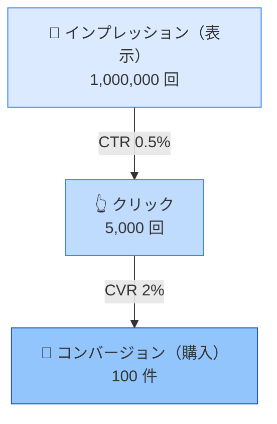
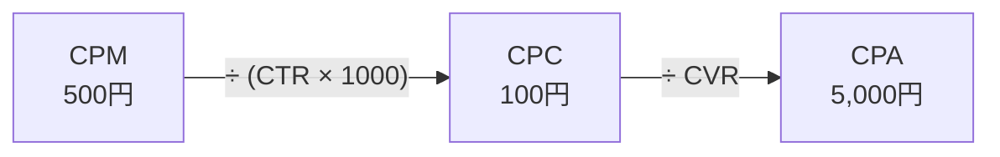
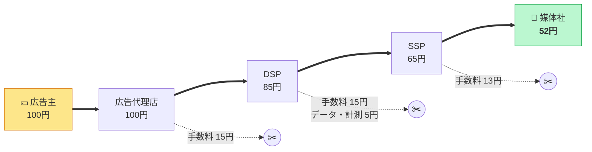
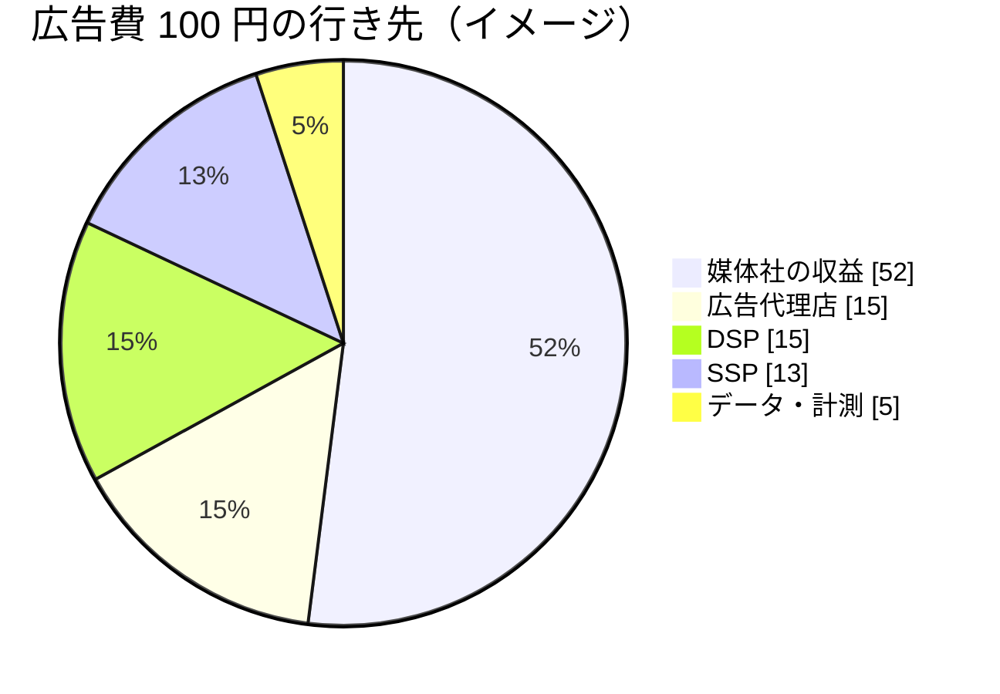

# 第9章 指標と計算式

> **この章のゴール**: 広告の成果を表す指標を計算できるようになり、「広告費がどこへ流れるか」をイメージできるようになる。

## 9.1 広告のファネル

広告は「表示 → クリック → 購入」と、段階を追うごとに人数が減っていきます。

## 9.2 主要な指標

### 広告主（買い手）が見る指標

| 指標 | 意味 | 計算式 |
|-----|------|-------|
| **CPM** | 1,000 回表示あたりのコスト | 広告費 ÷ 表示回数 × 1,000 |
| **CTR** | クリック率 | クリック数 ÷ 表示回数 |
| **CPC** | 1 クリックあたりのコスト | 広告費 ÷ クリック数 |
| **CVR** | コンバージョン率 | コンバージョン数 ÷ クリック数 |
| **CPA** | 1 コンバージョンあたりのコスト | 広告費 ÷ コンバージョン数 |
| **ROAS** | 広告費に対する売上 | 売上 ÷ 広告費 × 100% |

### 媒体社（売り手）・SSP が見る指標

| 指標 | 意味 | 計算式 |
|-----|------|-------|
| **eCPM** | 実質的な 1,000 表示あたりの収益 | 収益 ÷ 表示回数 × 1,000 |
| **Fill Rate** | 広告リクエストのうち実際に広告が埋まった割合 | 表示回数 ÷ 広告リクエスト数 |
| **Bid Rate** | Bid Request のうち入札があった割合 | 入札数 ÷ Bid Request 数 |
| **Viewability** | 表示のうち「見られた」割合 | Viewable 表示数 ÷ 計測可能な表示数 |

### DSP が見る指標

| 指標 | 意味 | 計算式 |
|-----|------|-------|
| **Win Rate** | 入札のうち勝った割合 | 落札数 ÷ 入札数 |
| **QPS** | 1 秒あたりに受け取る Bid Request 数 | — |

## 9.3 計算してみよう

あるキャンペーンの結果:

- 広告費: **50万円**
- 表示回数: **1,000,000 回**
- クリック数: **5,000 回**
- コンバージョン: **100 件**
- 売上: **150万円**

| 指標 | 計算 | 答え |
|-----|------|-----|
| CPM | 500,000 ÷ 1,000,000 × 1,000 | **500 円** |
| CTR | 5,000 ÷ 1,000,000 | **0.5%** |
| CPC | 500,000 ÷ 5,000 | **100 円** |
| CVR | 100 ÷ 5,000 | **2%** |
| CPA | 500,000 ÷ 100 | **5,000 円** |
| ROAS | 1,500,000 ÷ 500,000 | **300%** |

### 指標どうしの関係

$$
\text{CPC} = \frac{\text{CPM}}{\text{CTR} \times 1000}, \qquad
\text{CPA} = \frac{\text{CPC}}{\text{CVR}}
$$

この関係を逆にたどったのが、[第5章](05-dsp-bidding.md) の **入札額の計算式** です。

$$
\text{入札 CPM} = \text{CTR} \times \text{CVR} \times \text{CPA} \times 1000
$$

## 9.4 広告費はどこへ行く？

広告主が払った 100 円は、すべてが媒体社に届くわけではありません。途中のプレイヤーが手数料を取ります。
（数値はイメージです。実際の割合は取引によって大きく異なります）

この「中間で抜かれる部分」は **アドテク税（Ad Tech Tax）** とも呼ばれ、[第8章](08-quality-fraud.md) の SPO などで削減する取り組みが進んでいます。

---

⬅️ 前へ: [第8章 透明性・品質・不正対策](08-quality-fraud.md) ｜ ➡️ 次へ: [用語集](glossary.md)
