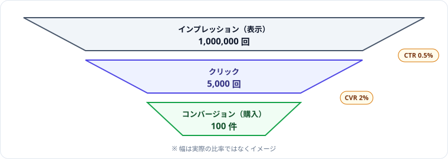
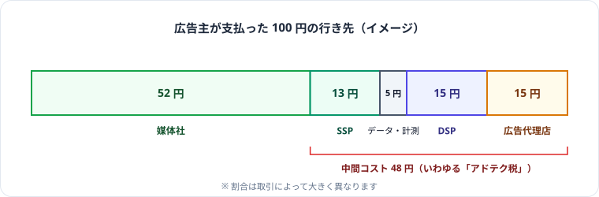

# 第9章 指標と計算式

広告の取引では、立場によって見るべき数字が異なります。本章では、広告主・媒体社・DSP がそれぞれ重視する指標と、その計算方法を整理します。

!!! abstract "この章で学ぶこと"

    - 表示からコンバージョンまでのファネルと、CTR・CVR の関係
    - 広告主・媒体社・DSP が見る主要な指標と計算式
    - 広告費が媒体社に届くまでに差し引かれるコスト

## 9.1 広告のファネル

広告は「表示 → クリック → 成果」と段階が進むごとに、到達する人数が減っていきます。

<figure markdown="span">
  { width="760" }
  <figcaption>図9-1　広告のファネル（数値は 9.3 節の計算例と共通）</figcaption>
</figure>

## 9.2 主要な指標

### 広告主（買い手）が見る指標

| 指標 | 意味 | 計算式 |
|-----|------|-------|
| **CPM** | 1,000 回表示あたりの費用 | 広告費 ÷ 表示回数 × 1,000 |
| **CTR** | クリック率 | クリック数 ÷ 表示回数 |
| **CPC** | 1 クリックあたりの費用 | 広告費 ÷ クリック数 |
| **CVR** | コンバージョン率 | コンバージョン数 ÷ クリック数 |
| **CPA** | 1 コンバージョンあたりの費用 | 広告費 ÷ コンバージョン数 |
| **ROAS** | 広告費に対する売上の比率 | 売上 ÷ 広告費 × 100% |

### 媒体社・SSP が見る指標

| 指標 | 意味 | 計算式 |
|-----|------|-------|
| **eCPM** | 1,000 回表示あたりの実質的な収益 | 収益 ÷ 表示回数 × 1,000 |
| **フィルレート** | 広告リクエストのうち、広告が表示された割合 | 表示回数 ÷ 広告リクエスト数 |
| **ビッドレート** | Bid Request のうち、入札があった割合 | 入札数 ÷ Bid Request 数 |
| **ビューアブル率** | 計測できた表示のうち、見られる状態にあった割合 | ビューアブルな表示数 ÷ 計測可能な表示数 |

### DSP が見る指標

| 指標 | 意味 | 計算式 |
|-----|------|-------|
| **勝率（Win Rate）** | 入札のうち落札できた割合 | 落札数 ÷ 入札数 |
| **QPS** | 1 秒あたりに受け取る Bid Request の数 | — |

## 9.3 計算例

あるキャンペーンの結果が次のとおりだったとします。

| 項目 | 値 |
|-----|-----|
| 広告費 | 500,000 円 |
| 表示回数 | 1,000,000 回 |
| クリック数 | 5,000 回 |
| コンバージョン数 | 100 件 |
| 売上 | 1,500,000 円 |

| 指標 | 計算 | 結果 |
|-----|------|-----|
| CPM | 500,000 ÷ 1,000,000 × 1,000 | **500 円** |
| CTR | 5,000 ÷ 1,000,000 | **0.5%** |
| CPC | 500,000 ÷ 5,000 | **100 円** |
| CVR | 100 ÷ 5,000 | **2%** |
| CPA | 500,000 ÷ 100 | **5,000 円** |
| ROAS | 1,500,000 ÷ 500,000 × 100% | **300%** |

### 指標どうしの関係

CPM・CPC・CPA は、CTR と CVR を介して次のように結びついています。

$$
\text{CPC} = \frac{\text{CPM}}{\text{CTR} \times 1000}, \qquad
\text{CPA} = \frac{\text{CPC}}{\text{CVR}}
$$

この関係を逆向きにたどったものが、[第5章](05-dsp-bidding.md)で説明した入札額の計算式です。

$$
\text{入札額（CPM）} = \text{CTR} \times \text{CVR} \times \text{CPA} \times 1000
$$

!!! example "検算"

    9.3 節の例に当てはめると、$0.005 \times 0.02 \times 5000 \times 1000 = 500$ となり、CPM の 500 円と一致します。

## 9.4 広告費の行き先

広告主が支払った広告費は、すべてが媒体社に届くわけではありません。広告代理店・DSP・データ事業者・SSP などがそれぞれ手数料を受け取ります。

<figure markdown="span">
  { width="760" }
  <figcaption>図9-2　広告費 100 円の行き先（割合は説明用の例）</figcaption>
</figure>

この中間コストは「**アドテク税（Ad Tech Tax）**」と呼ばれることもあり、[第8章](08-quality-fraud.md)で説明した SPO などによって削減する取り組みが進んでいます。

!!! success "この章のまとめ"

    - 広告主は CPM・CPC・CPA・ROAS、媒体社は eCPM・フィルレート、DSP は勝率などを重視する
    - CPM・CPC・CPA は CTR と CVR を介して相互に変換でき、その逆算が入札額の計算式になる
    - 広告費の一部は中間事業者の手数料となり、媒体社に届くのはその残りである
