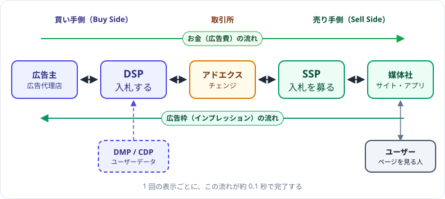

---
hide:
  - navigation
  - toc
---

図解で学ぶアドテクノロジー

# RTB 入門 { .cover-title }

デジタル広告のリアルタイム入札を、ゼロから理解する

yasut0ra 著　｜　第 1.0 版（2026 年 11 月）

[はじめに](preface.md){ .md-button .md-button--primary }
[第1章から読む](01-overview.md){ .md-button }

Web ページを開いた瞬間、画面の広告枠をめぐって、複数の企業が約 0.1 秒のオークションで値段を競い合っています。本書は、この **RTB（Real-Time Bidding）** の仕組みを、図とたとえ話を使ってゼロから解説する学習書です。

<figure markdown="span">
  { width="760" }
</figure>

## 目次

| 部 | 章 | 内容 |
|----|----|------|
| 基礎 | [第1章 デジタル広告の全体像](01-overview.md) | 登場するプレイヤーと RTB が生まれた背景 |
| | [第2章 RTB の流れ](02-rtb-flow.md) | 広告リクエストから表示までの約 0.1 秒 |
| | [第3章 OpenRTB プロトコル](03-openrtb.md) | Bid Request と Bid Response の中身 |
| 仕組みと戦略 | [第4章 オークション方式](04-auction.md) | セカンドプライス、ファーストプライス、ヘッダービディング |
| | [第5章 DSP の入札ロジック](05-dsp-bidding.md) | 入札額の計算、CTR 予測、予算ペーシング |
| | [第6章 取引形態](06-deals.md) | オープンオークション、PMP、プログラマティック保証型 |
| 周辺の課題 | [第7章 プライバシーと識別子](07-privacy.md) | Cookie、広告 ID、同意管理、法規制 |
| | [第8章 透明性・品質・不正対策](08-quality-fraud.md) | ads.txt、sellers.json、アドフラウド、ビューアビリティ |
| | [第9章 指標と計算式](09-metrics.md) | CPM、CTR、CPA、ROAS |
| 付録 | [用語集](glossary.md)・[確認問題](quiz.md)・[参考文献](references.md) | 復習と調べもの |

## ハンズオン教材

| 教材 | 内容 |
|------|------|
| [examples/bid_request.json](examples/bid_request.json) | OpenRTB 2.6 形式の Bid Request のサンプル |
| [examples/bid_response.json](examples/bid_response.json) | 上記に対する Bid Response のサンプル |
| [examples/auction_simulator.py](examples/auction_simulator.py) | オークション方式やフロアプライスによる収益の違いを確かめるシミュレーター |
