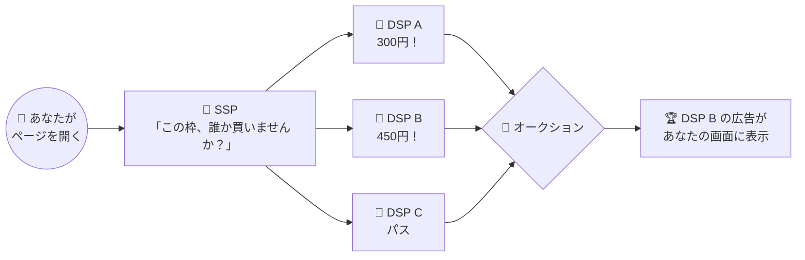
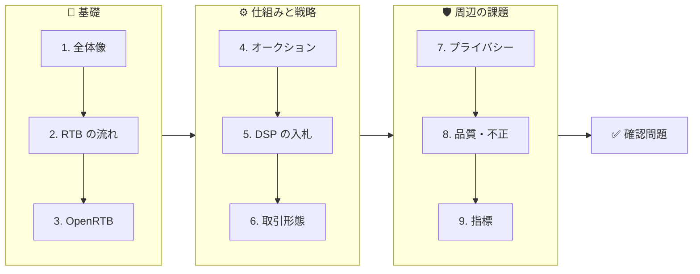

# RTB（リアルタイム入札）入門 — デジタル広告の仕組みを学ぶ

Webページやアプリに広告が表示されるまでの **約100ミリ秒** の間に、裏側では「オークション」が行われています。
この仕組みが **RTB（Real-Time Bidding）** です。

この資料は、RTB をはじめて学ぶ人が **全体像 → 仕組み → プロトコル → 戦略 → 周辺課題** の順に理解できるように構成しています。
なるべく **図とたとえ話** で説明しているので、専門知識がなくても読み進められます。



<p style="text-align:center"><b>↑ これが約 0.1 秒で、1 日に何千億回も行われています</b></p>

## 学習ロードマップ



## 対象読者

- デジタル広告業界に入ったばかりの人（エンジニア・営業・企画）
- アドテク系の研究・開発に興味がある学生
- 「なぜ見たばかりの商品の広告が出てくるの？」を仕組みから知りたい人

## 目次

| # | 章 | 内容 |
|---|----|------|
| 1 | [デジタル広告の全体像](01-overview.md) | 登場人物（広告主・媒体・DSP・SSP・アドエクスチェンジ） |
| 2 | [RTB の流れ](02-rtb-flow.md) | 広告リクエストから表示までの 100ms |
| 3 | [OpenRTB プロトコル](03-openrtb.md) | Bid Request / Bid Response の中身 |
| 4 | [オークション方式](04-auction.md) | セカンドプライス・ファーストプライス・ビッドシェーディング・ヘッダービディング |
| 5 | [DSP の入札ロジック](05-dsp-bidding.md) | CTR/CVR 予測・入札額の決め方・予算ペーシング |
| 6 | [取引形態](06-deals.md) | オープンオークション・PMP・プログラマティック保証型 |
| 7 | [プライバシーと識別子](07-privacy.md) | Cookie・広告ID・同意管理・法規制 |
| 8 | [透明性・品質・不正対策](08-quality-fraud.md) | ads.txt・sellers.json・アドフラウド・ビューアビリティ |
| 9 | [指標と計算式](09-metrics.md) | CPM・CTR・eCPM・ROAS などの KPI |
| – | [用語集](glossary.md) | 頻出用語まとめ |
| – | [確認問題](quiz.md) | 理解度チェック（解答付き） |

## ハンズオン

| ファイル | 内容 |
|----------|------|
| [examples/bid_request.json](examples/bid_request.json) | OpenRTB 2.6 形式の Bid Request サンプル |
| [examples/bid_response.json](examples/bid_response.json) | 上記に対する Bid Response サンプル |
| [examples/auction_simulator.py](examples/auction_simulator.py) | オークション方式ごとの収益を比較するシミュレーター（Python 標準ライブラリのみ） |

```bash
python docs/examples/auction_simulator.py
```

## おすすめの読み方

1. **まず 1〜2 章** を読んで、登場人物と流れをつかむ
2. **3 章** でサンプル JSON を見ながら、実際にやり取りされるデータを確認
3. **4 章** を読んだあとシミュレーターを動かし、オークション方式の違いを体感
4. 残りの章は興味に応じて
5. 最後に [確認問題](quiz.md) で復習

## 参考資料（一次情報）

- [IAB Tech Lab — OpenRTB](https://iabtechlab.com/standards/openrtb/)
- [OpenRTB 2.6 仕様（GitHub）](https://github.com/InteractiveAdvertisingBureau/openrtb2.x)
- [IAB Tech Lab — ads.txt / sellers.json](https://iabtechlab.com/ads-txt/)
- [Prebid.org（ヘッダービディング）](https://docs.prebid.org/)
- [MRC — Viewable Ad Impression Guidelines](https://mediaratingcouncil.org/)

> **注意**: アドテク業界は変化が速く、特にプライバシー関連（Cookie・ブラウザの仕様・法規制）は頻繁に状況が変わります。
> 本資料は 2026 年 11 月時点の理解に基づいています。実務で使う際は必ず一次情報を確認してください。
